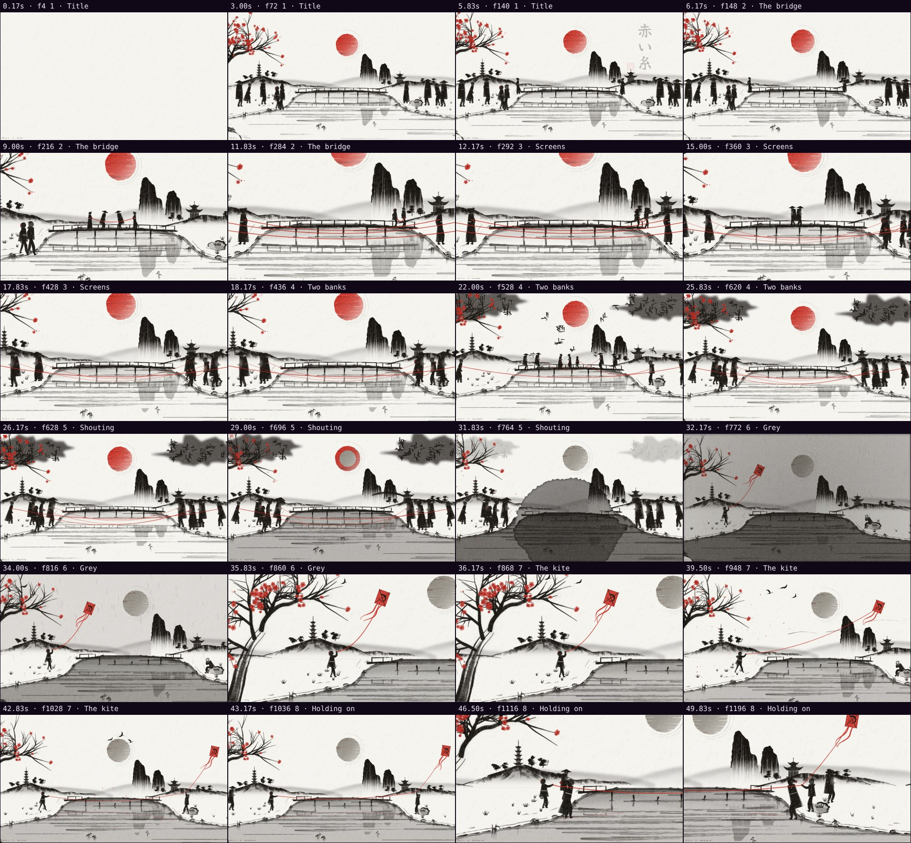
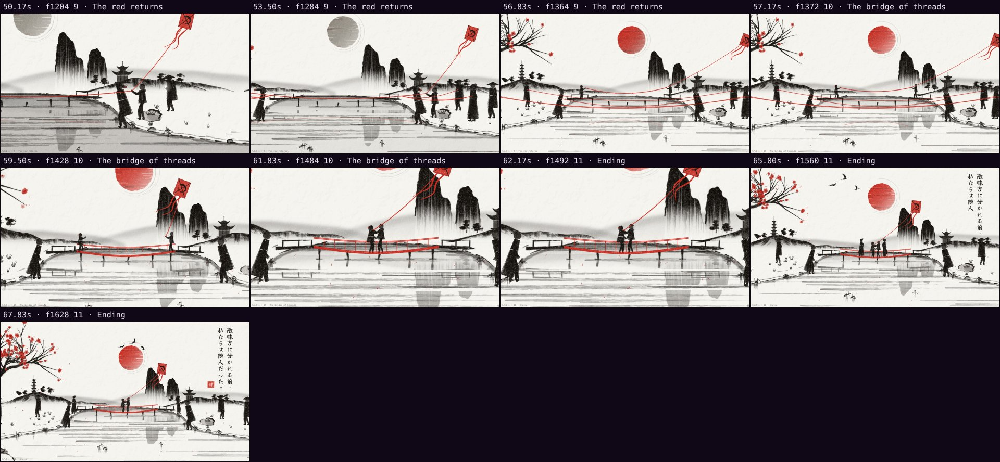

# Automatic review · sandbox/2026-11-04-red-thread/scene.js

960×540 px · 24 fps · 68.00 s · 1632 frames · 60 BPM

## Warnings

- **Flat frames** (a single color) at 0.00 s, 0.17 s.

## Motion

Energy per second (how much the image changes):

```
▁▃▂▃▃▃▅▅▅▅▅▄▃▄▄▄▅▄▃▄▄▄▄▄▃▂▂▃▃▃▂▅▅▅▇▇▄▆▇▇▄▃▂▇▆▄▆█▆▄▅▆▅▆▆▅▄▄▆▆▅▄▆▇▅▄▄▃
0    5    10   15   20   25   30   35   40   45   50   55   60   65   
```

No still stretches of 1 s or more.

## Speed

Painting: 676 ms/frame cold, 136 ms warm → full render ≈ 221 s at this size.

## Contact sheet



