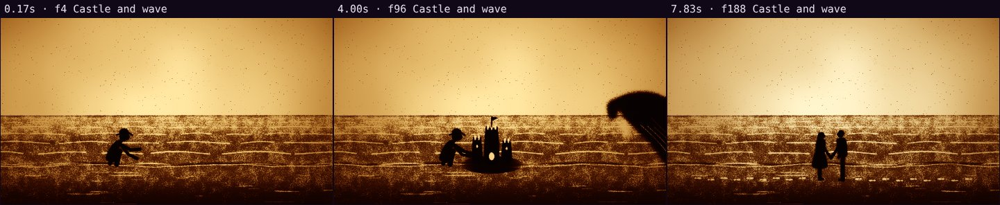

# Automatic review · sandbox/2026-11-04-tide/scene.js

960×540 px · 24 fps · 8.00 s · 192 frames · 60 BPM

## Warnings

- None.

## Motion

Energy per second (how much the image changes):

```
▂▂▂▂█▄▃▂
0    5    
```

No still stretches of 1 s or more.

## Speed

Painting: 49 ms/frame cold, 37 ms warm → full render ≈ 7 s at this size.

## Contact sheet


