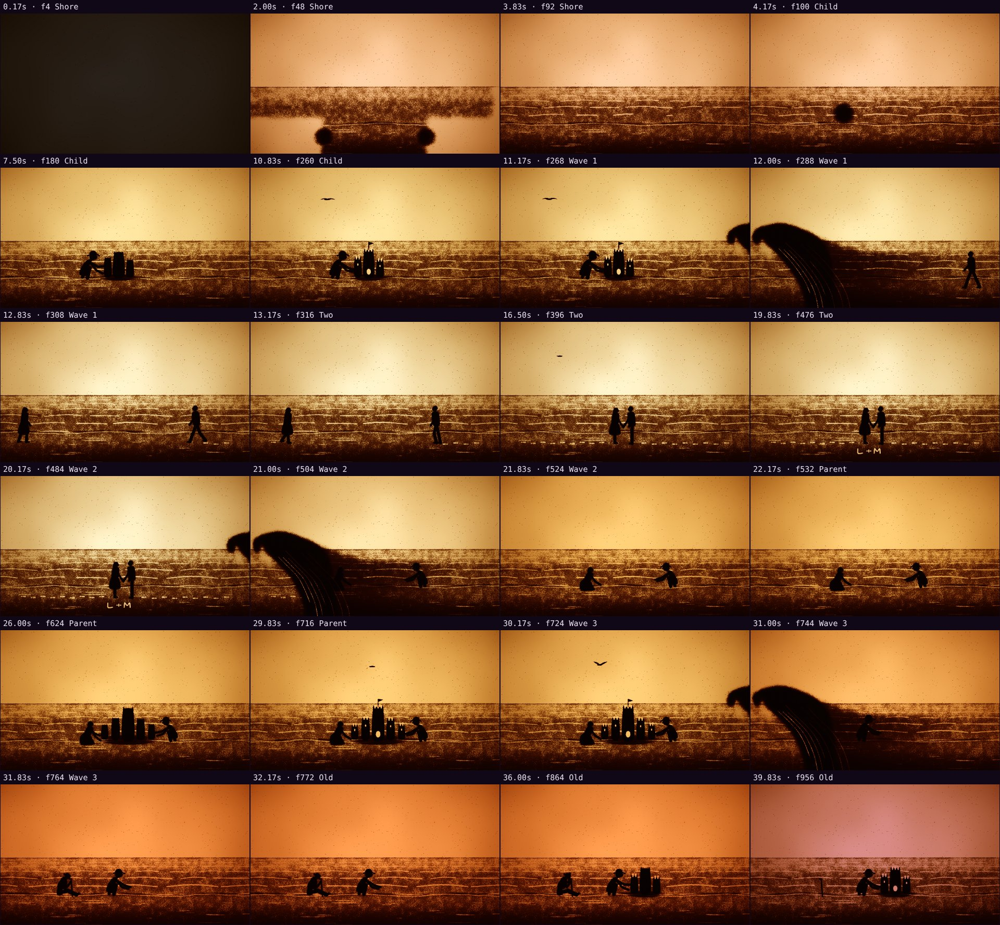
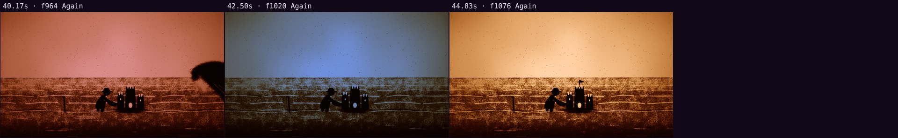

# Automatic review · sandbox/2026-11-04-tide/scene.js

960×540 px · 24 fps · 45.00 s · 1080 frames · 60 BPM

## Warnings

- None.

## Motion

Energy per second (how much the image changes):

```
█▄▃▁▂▁▁▁▁▁▁▆▄▂▂▁▁▁▁▁▆▄▁▁▁▁▁▁▁▁▆▄▁▁▁▁▁▁▂▃▄▂▂▄▁
0    5    10   15   20   25   30   35   40   
```

No still stretches of 1 s or more.

Large jumps outside cuts (can be normal in dense patterns; check whether they bother): 0.67 s.

## Speed

Painting: 49 ms/frame cold, 35 ms warm → full render ≈ 38 s at this size.

## Contact sheet



