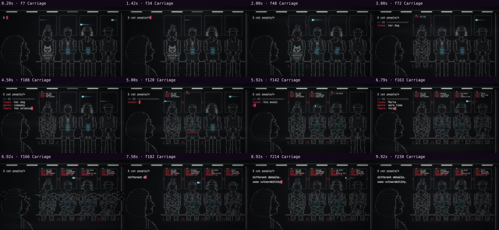

# Automatic review · sandbox/2026-11-10-one-or-zero/scene.js

960×540 px · 24 fps · 10.00 s · 240 frames · 96 BPM

## Warnings

- None.

## Motion

Energy per second (how much the image changes):

```
▇▇█▇▇▇█▇▇▆
0    5    
```

No still stretches of 1 s or more.

## Speed

Painting: 109 ms/frame cold, 73 ms warm → full render ≈ 18 s at this size.

## Contact sheet


