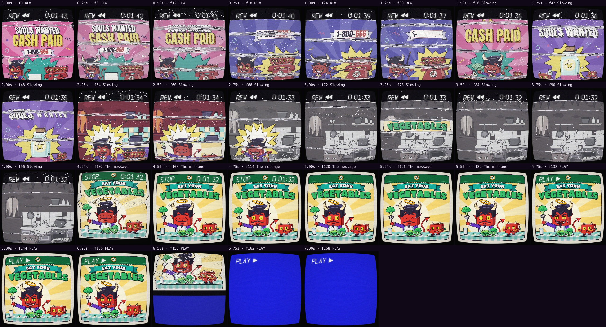

# Automatic review · sandbox/2026-11-11-runnin-down-a-dream/dev/breakrew/scene.js

960×960 px · 24 fps · 7.08 s · 170 frames · 169.97 BPM

## Warnings

- None.

## Motion

Energy per second (how much the image changes):

```
▇▇█▆▆▄▆ 
0    5    
```

No still stretches of 1 s or more.

Large jumps outside cuts (can be normal in dense patterns; check whether they bother): 0.83 s, 2.17 s, 2.83 s, 3.00 s, 3.67 s, 3.83 s, 6.50 s, 6.67 s.

## Speed

Painting: 109 ms/frame cold, 87 ms warm → full render ≈ 15 s at this size.

## Contact sheet


