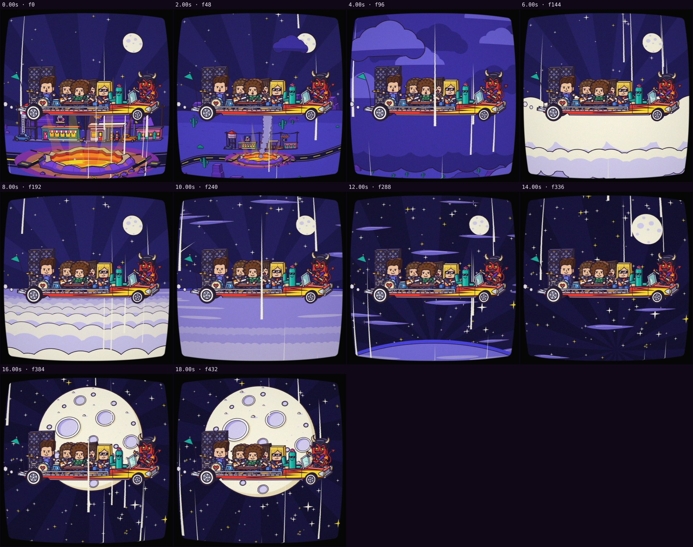

# Automatic review · sandbox/2026-11-11-runnin-down-a-dream/dev/finale/scene.js

960×960 px · 24 fps · 20.00 s · 480 frames

## Warnings

- None.

## Motion

Energy per second (how much the image changes):

```
▅▅▅▆▇█▄▄▅▄▅▅▅▅▅▅▄▄▄▄
0    5    10   15   
```

No still stretches of 1 s or more.

Large jumps outside cuts (can be normal in dense patterns; check whether they bother): 5.17 s, 5.33 s.

## Speed

Painting: 214 ms/frame cold, 144 ms warm → full render ≈ 69 s at this size.

## Contact sheet


