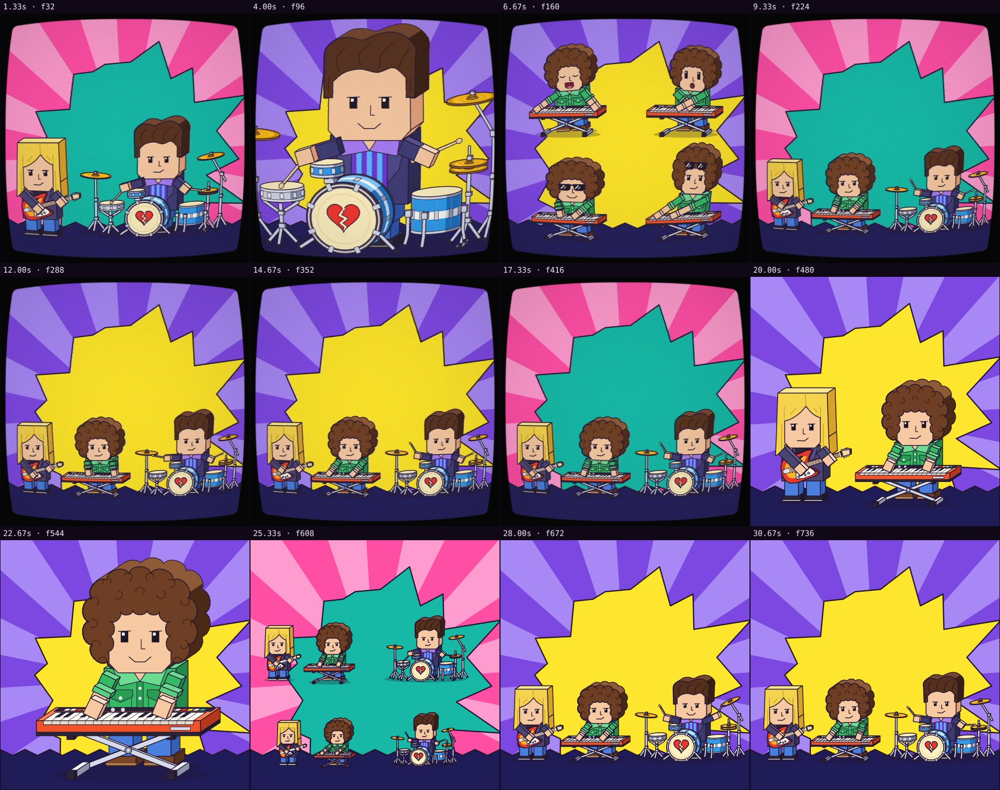

# Automatic review · sandbox/2026-11-11-runnin-down-a-dream/dev/rhythm/scene.js

960×960 px · 24 fps · 32.00 s · 768 frames

## Warnings

- None.

## Motion

Energy per second (how much the image changes):

```
▇▇▇▇▇▇▇▇▇▇▇▆▇▇▇▇▇▆▇█▆▇▆▇▇▇▇▇▇▇▇▃
0    5    10   15   20   25   30   
```

No still stretches of 1 s or more.

Large jumps outside cuts (can be normal in dense patterns; check whether they bother): 1.00 s, 2.00 s, 3.00 s, 4.00 s, 5.00 s, 6.00 s, 7.00 s, 8.00 s, 20.00 s, 21.00 s, 22.00 s, 23.00 s.

## Speed

Painting: 77 ms/frame cold, 56 ms warm → full render ≈ 43 s at this size.

## Contact sheet


