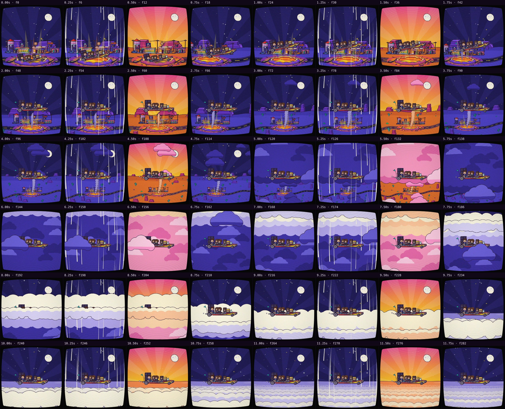
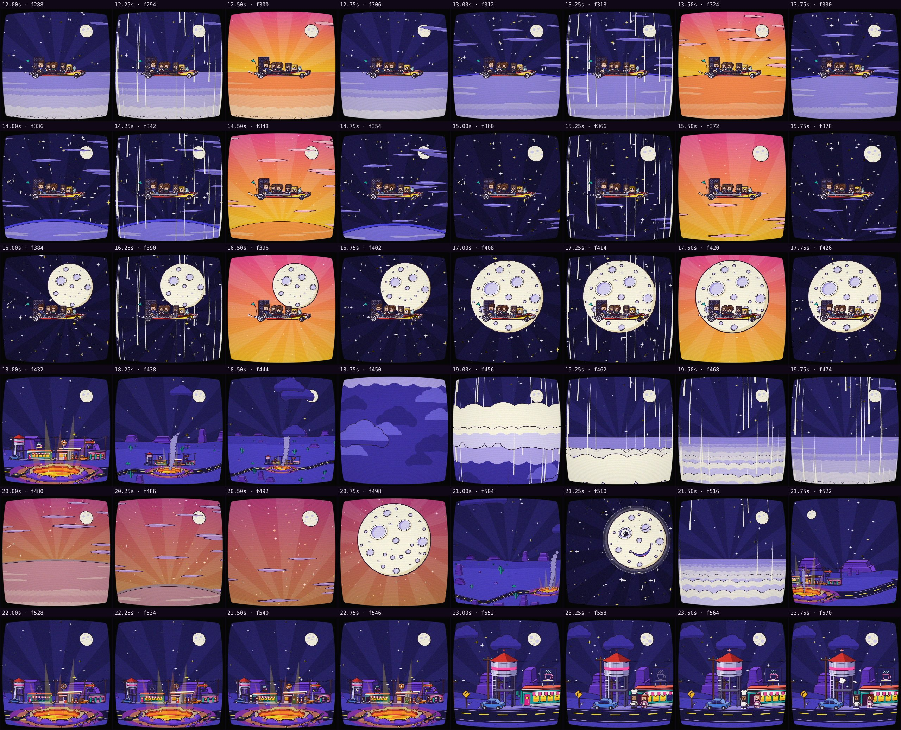
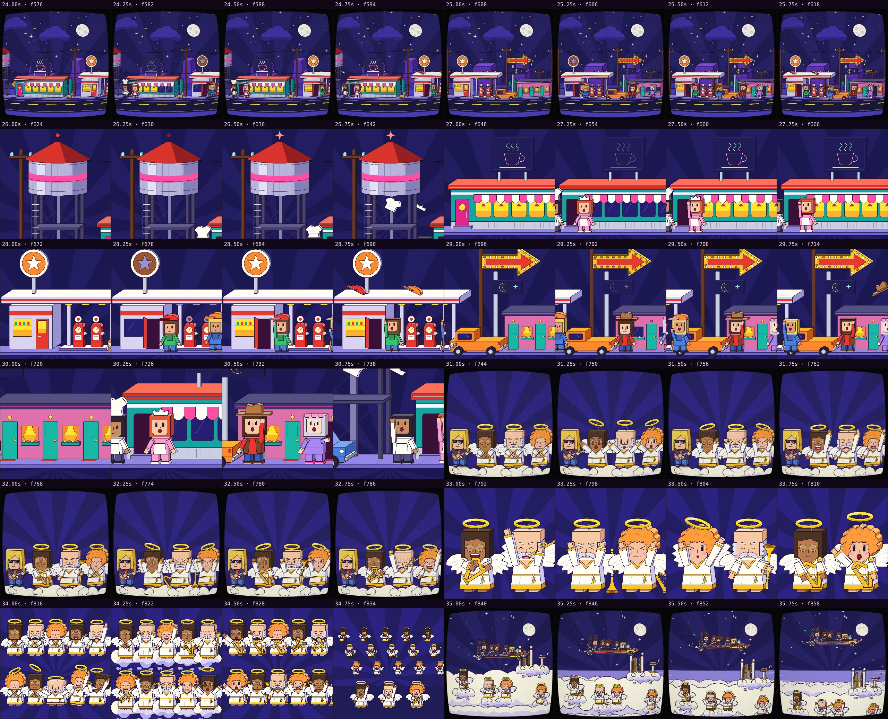
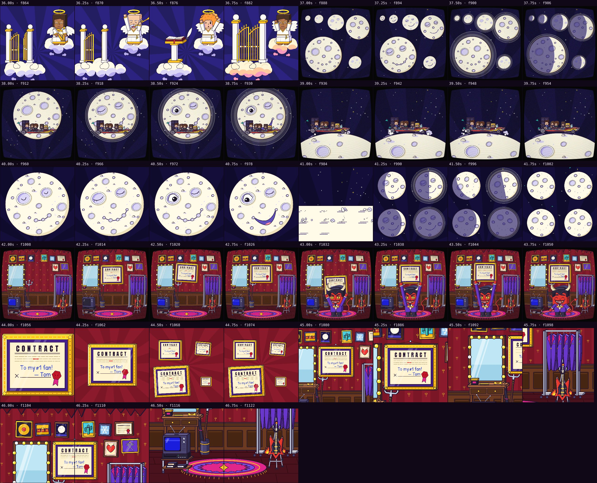

# Automatic review · sandbox/2026-11-11-runnin-down-a-dream/dev/skyward/scene.js

960×960 px · 24 fps · 47.00 s · 1128 frames

## Warnings

- **Flashes** more than 3 per second (photosensitivity risk): 34–35 s (4). Soften the brightness changes or lower the contrast.
- **Transparent holes** (the empty canvas shows through: a background that doesn't cover the camera, or nothing painted) at 45.67 s (4.2 %), 45.83 s (4.2 %).

## Motion

Energy per second (how much the image changes):

```
▆▆▆▆▆▆▇▆▆▅▆▆▆▆▇▇▇▇▆▆▆▇▃▃▃▄▄▅▅▄▇▃▅▆█▆▆▅▅▅▅█▃▅▇█▇
0    5    10   15   20   25   30   35   40   45   
```

No still stretches of 1 s or more.

Large jumps outside cuts (can be normal in dense patterns; check whether they bother): 0.50 s, 0.67 s, 1.50 s, 1.67 s, 2.50 s, 2.67 s, 3.50 s, 3.67 s, 4.50 s, 4.67 s, 5.50 s, 5.67 s.

## Speed

Painting: 140 ms/frame cold, 113 ms warm → full render ≈ 128 s at this size.

## Contact sheet





