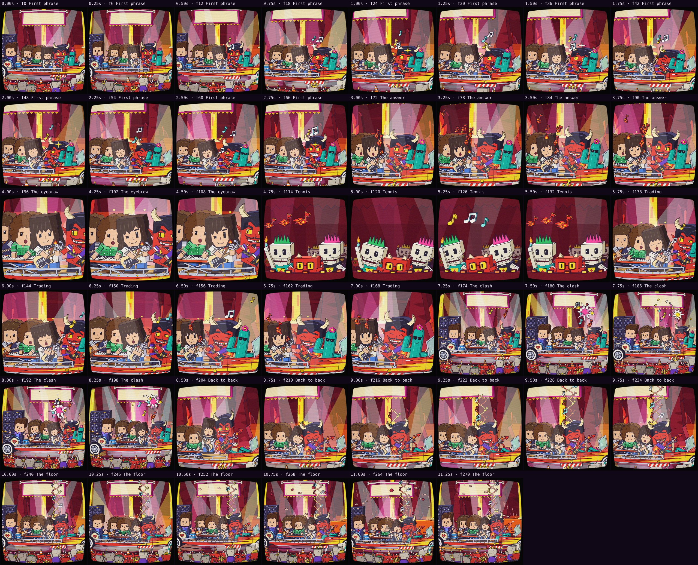

# Automatic review · sandbox/2026-11-11-runnin-down-a-dream/dev/solo1/scene.js

960×960 px · 24 fps · 11.29 s · 271 frames · 169.97 BPM

## Warnings

- None.

## Motion

Energy per second (how much the image changes):

```
▇▆▇▆▆▇▆▇▇▇▆█
0    5    10   
```

No still stretches of 1 s or more.

Large jumps outside cuts (can be normal in dense patterns; check whether they bother): 0.67 s, 0.83 s, 6.50 s, 11.17 s.

## Speed

Painting: 200 ms/frame cold, 112 ms warm → full render ≈ 30 s at this size.

## Contact sheet


