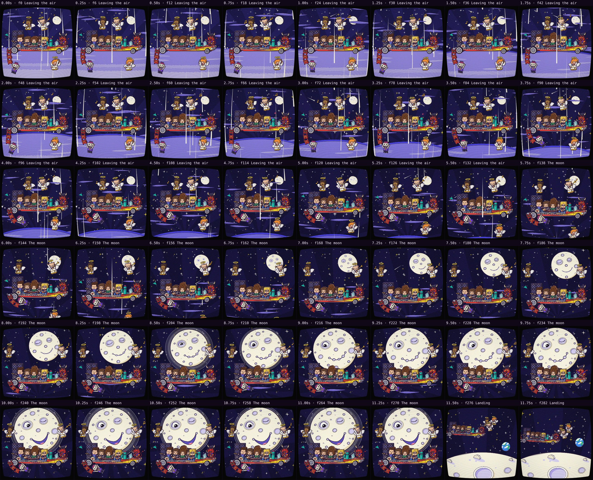
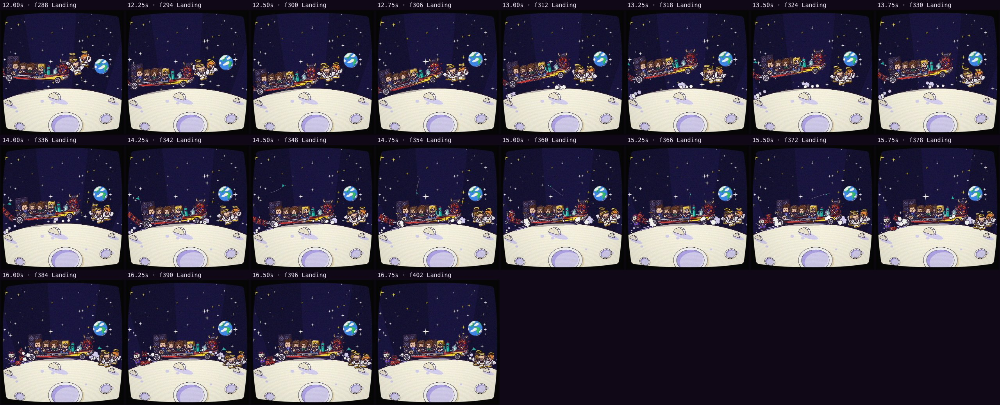

# Automatic review · sandbox/2026-11-11-runnin-down-a-dream/dev/solo4/scene.js

960×960 px · 24 fps · 16.96 s · 407 frames · 169.97 BPM

## Warnings

- None.

## Motion

Energy per second (how much the image changes):

```
▆▆▇▆▇▇▇▆▆▅▅█▅▅▄▄▃
0    5    10   15   
```

No still stretches of 1 s or more.

## Speed

Painting: 279 ms/frame cold, 360 ms warm → full render ≈ 146 s at this size.

## Contact sheet



