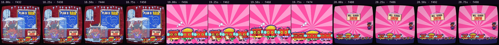

# Automatic review · sandbox/2026-11-11-runnin-down-a-dream/dev/weather/scene.js

960×960 px · 24 fps · 21.00 s · 504 frames

## Warnings

- None.

## Motion

Energy per second (how much the image changes):

```
▆▆▆▆▆▆▅▅▆▅█▆▆▆▇▇▇▅▇▆▃
0    5    10   15   20   
```

No still stretches of 1 s or more.

Large jumps outside cuts (can be normal in dense patterns; check whether they bother): 1.00 s, 2.00 s, 3.00 s, 4.00 s, 5.00 s, 9.00 s, 10.67 s, 11.00 s, 12.00 s, 13.00 s, 14.00 s, 15.00 s.

## Speed

Painting: 98 ms/frame cold, 73 ms warm → full render ≈ 37 s at this size.

## Contact sheet



