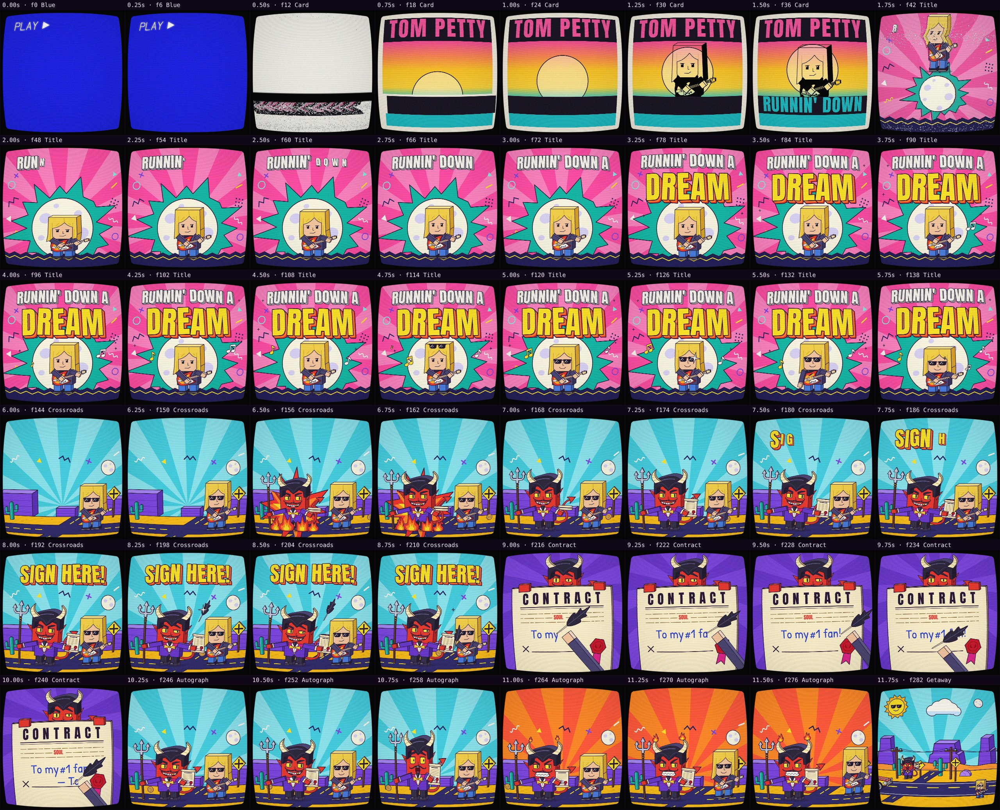
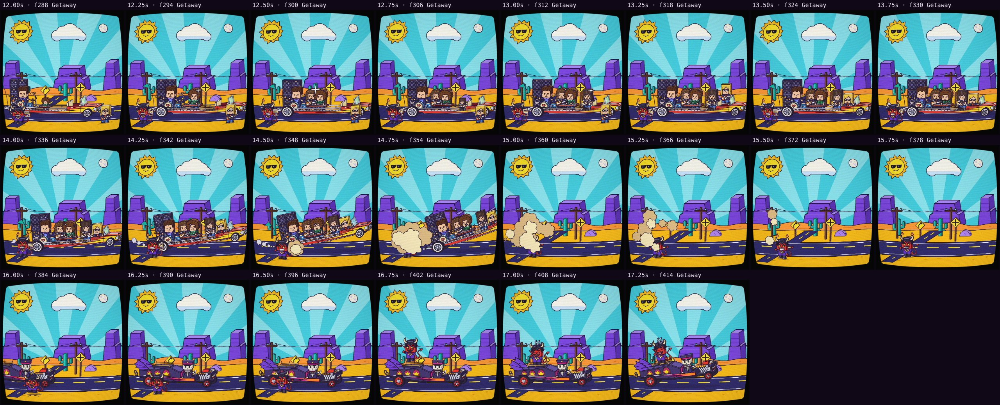

# Automatic review · sandbox/2026-11-11-runnin-down-a-dream/scene.js

960×960 px · 24 fps · 17.29 s · 415 frames · 169.97 BPM

## Warnings

- **Cuts off the beat** (169.97 BPM): 0.50 s (144 ms off the beat).

## Motion

Energy per second (how much the image changes):

```
█▆▅▅▅▆▅▅▇▄▇▆▄▄▅▃▃▄
0    5    10   15   
```

No still stretches of 1 s or more.

## Speed

Painting: 110 ms/frame cold, 87 ms warm → full render ≈ 36 s at this size.

## Contact sheet



