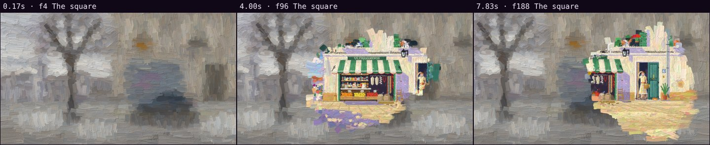

# Automatic review · sandbox/2026-11-12-oil-test/scene.js

960×540 px · 24 fps · 8.00 s · 192 frames

## Warnings

- None.

## Motion

Energy per second (how much the image changes):

```
▂▄█▄▅▇▃▃
0    5    
```

No still stretches of 1 s or more.

## Speed

Painting: 439 ms/frame cold, 425 ms warm → full render ≈ 82 s at this size.

> Slow: cache static elements with `Motion.sprite` and lower the texture density.

## Contact sheet


