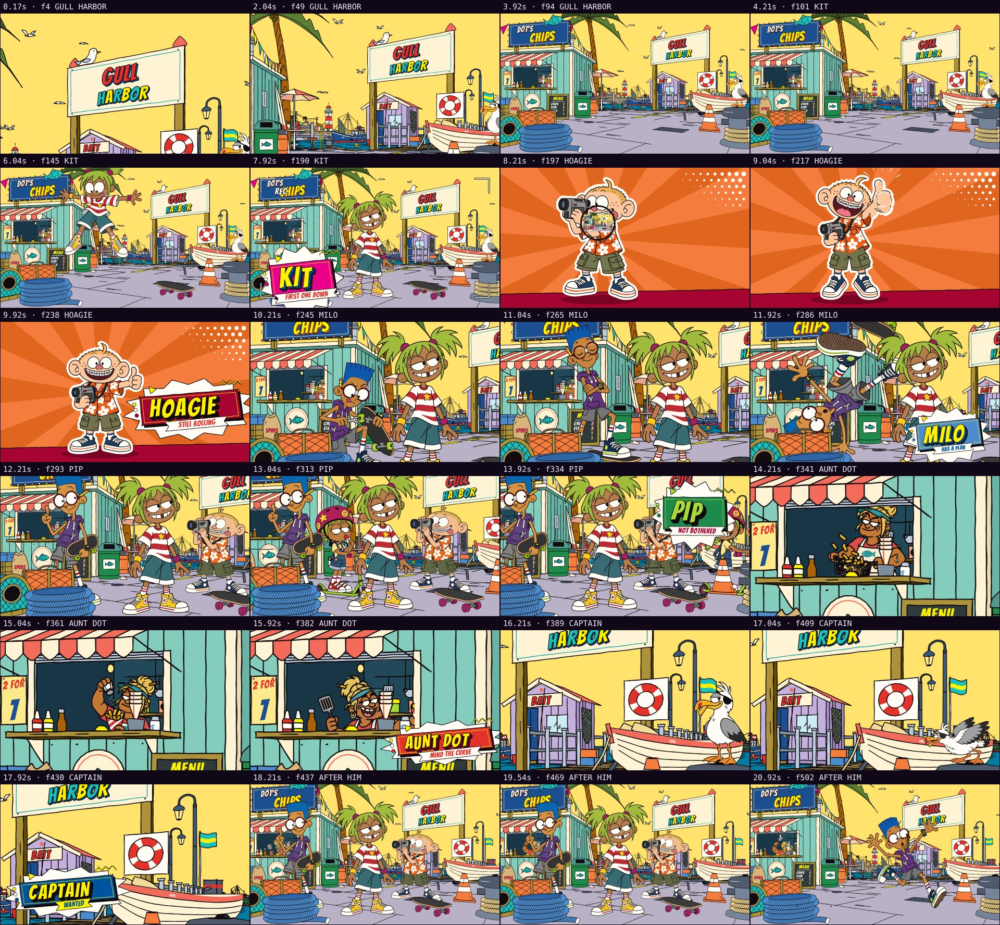

# Automatic review · sandbox/2026-11-14-pier-pressure/scene.js

960×540 px · 24 fps · 31.75 s · 762 frames · 120 BPM

## Warnings

- None.

## Motion

Energy per second (how much the image changes):

```
▃▇█▃▃▄▆▄▆▆▅▅▆▅▆▅▇▆▆▄▇▇▆▆▇▇▇█▆▇▇▄
0    5    10   15   20   25   30   
```

No still stretches of 1 s or more.

Large jumps outside cuts (can be normal in dense patterns; check whether they bother): 2.00 s, 2.17 s, 2.33 s, 2.50 s, 24.17 s, 30.50 s.

## Speed

Painting: 235 ms/frame cold, 145 ms warm → full render ≈ 110 s at this size.

## Contact sheet



