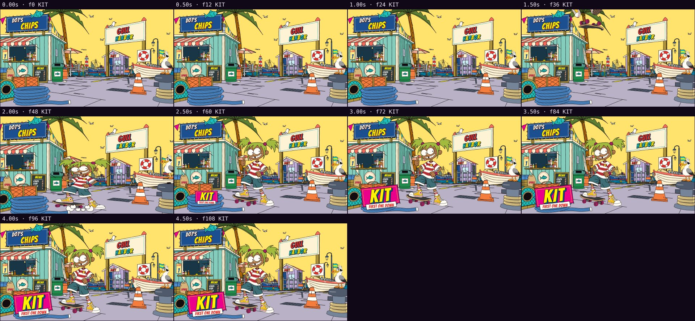

# Automatic review · sandbox/2026-11-14-pier-pressure/scene.js

960×540 px · 24 fps · 5.00 s · 120 frames · 120 BPM

## Warnings

- None.

## Motion

Energy per second (how much the image changes):

```
▂▇█▄▃
0    
```

No still stretches of 1 s or more.

Large jumps outside cuts (can be normal in dense patterns; check whether they bother): 2.00 s, 2.33 s.

## Speed

Painting: 88 ms/frame cold, 20 ms warm → full render ≈ 2 s at this size.

## Contact sheet


