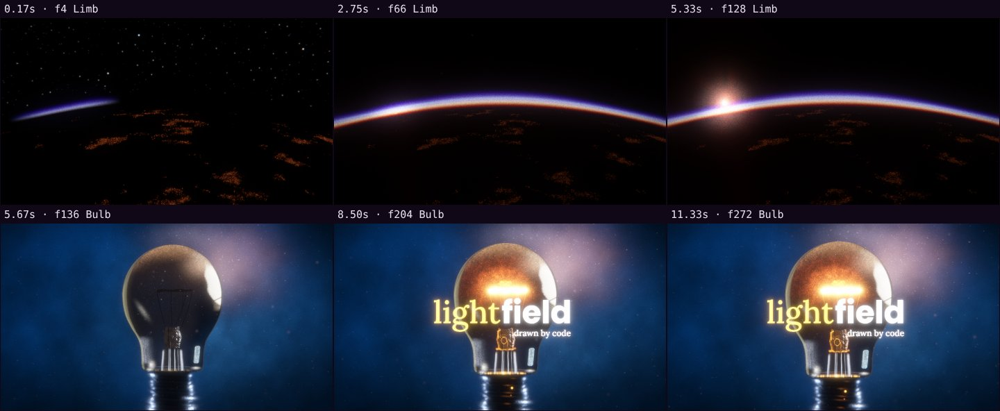

# Automatic review · sandbox/2026-11-16-lightfield-test/scene.js

960×540 px · 24 fps · 11.50 s · 276 frames

## Warnings

- None.

## Motion

Energy per second (how much the image changes):

```
▂▃▂▃▂█▄▅▄▃▃▃
0    5    10   
```

No still stretches of 1 s or more.

## Speed

Painting: 980 ms/frame cold, 672 ms warm → full render ≈ 186 s at this size.

> Slow: cache static elements with `Motion.sprite` and lower the texture density.

## Contact sheet


