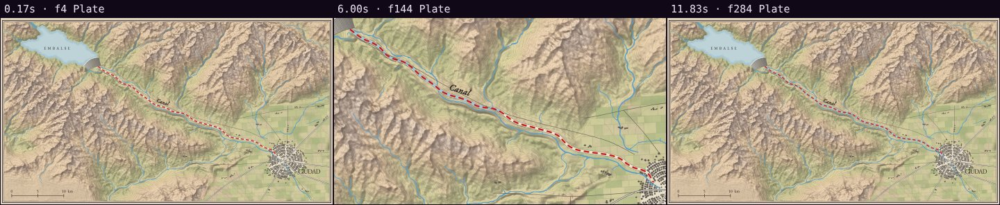

# Automatic review · sandbox/2026-11-17-atlas-test/scene.js

960×540 px · 24 fps · 12.00 s · 288 frames

## Warnings

- None.

## Motion

Energy per second (how much the image changes):

```
  ▇▄██▇▄ ▅▇▃
0    5    10   
```

Still stretches of 1 s or more (intended? a visual pause that looks like a glitch is a bug): 0.00 s–2.00 s, 7.50 s–9.33 s.

## Speed

Painting: 495 ms/frame cold, 518 ms warm → full render ≈ 149 s at this size.

> Slow: cache static elements with `Motion.sprite` and lower the texture density.

## Contact sheet


