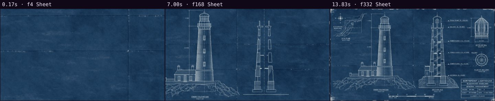

# Automatic review · sandbox/2026-11-17-blueprint-test/scene.js

960×540 px · 24 fps · 14.00 s · 336 frames

## Warnings

- None.

## Motion

Energy per second (how much the image changes):

```
▁▅▅▃▂▇▅▁▃█▃▁  
0    5    10   
```

Still stretches of 1 s or more (intended? a visual pause that looks like a glitch is a bug): 11.50 s–13.83 s.

## Speed

Painting: 283 ms/frame cold, 20 ms warm → full render ≈ 7 s at this size.

## Contact sheet


