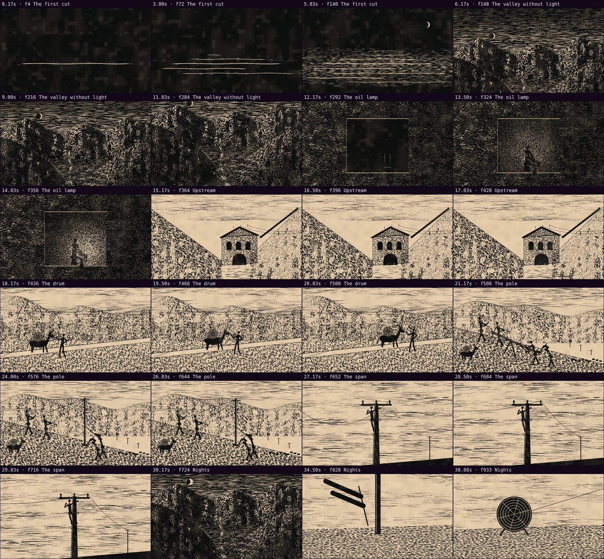
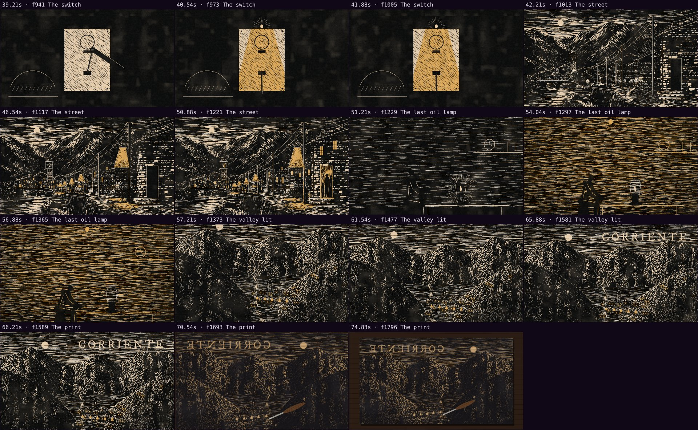

# Automatic review · sandbox/2026-11-17-light-valley/scene.js

960×540 px · 24 fps · 75.00 s · 1800 frames · 79.92 BPM

## Warnings

- None.

## Motion

Energy per second (how much the image changes):

```
▃▃▃▃▃▆▅███▇▅▃▃▆▂▂▄▃▃▅▂▂▃▂▂▄▁▁▆▃▆▆▃▆▆▃▆▆▄▃▃▄▃▃▃▃▃▃▃▃▅▂▂▂▂▂▄▃▅██▆▄▃▃▂█▃▁▃▄▃▂ 
0    5    10   15   20   25   30   35   40   45   50   55   60   65   70   
```

Still stretches of 1 s or more (intended? a visual pause that looks like a glitch is a bug): 73.83 s–74.83 s.

Large jumps outside cuts (can be normal in dense patterns; check whether they bother): 7.33 s, 7.50 s, 7.67 s, 7.83 s, 8.00 s, 8.17 s, 8.33 s, 8.50 s, 8.67 s, 8.83 s, 9.00 s, 9.17 s.

## Speed

Painting: 174 ms/frame cold, 30 ms warm → full render ≈ 53 s at this size.

## Contact sheet



