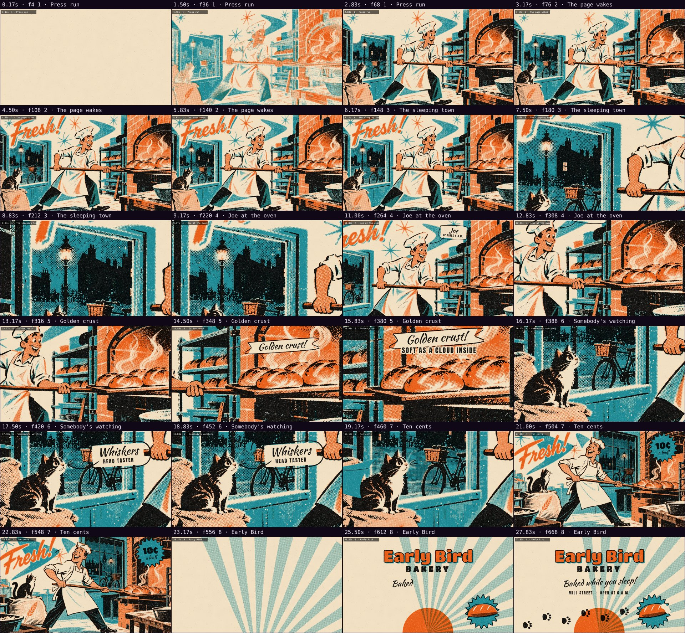

# Automatic review · sandbox/2026-11-17-magazine-ad-test/scene.js

960×540 px · 24 fps · 30.00 s · 720 frames · 120 BPM

## Warnings

- None.

## Motion

Energy per second (how much the image changes):

```
▃▃▄▃▃▃▇█▄▇▁▄▇▆█▆▅▅▅▄▃▃▅▃▂▁▁▃▂▂
0    5    10   15   20   25   
```

No still stretches of 1 s or more.

Large jumps outside cuts (can be normal in dense patterns; check whether they bother): 2.50 s, 6.50 s, 6.67 s, 6.83 s, 7.00 s, 7.17 s, 7.33 s, 7.50 s, 7.67 s, 7.83 s, 8.00 s, 8.17 s.

## Speed

Painting: 304 ms/frame cold, 282 ms warm → full render ≈ 203 s at this size.

## Contact sheet



