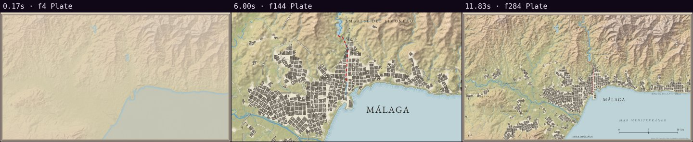

# Automatic review · sandbox/2026-11-17-malaga-atlas/scene.js

960×540 px · 24 fps · 12.00 s · 288 frames

## Warnings

- None.

## Motion

Energy per second (how much the image changes):

```
▃▁█▆██▇▄▃▇▅ 
0    5    10   
```

Still stretches of 1 s or more (intended? a visual pause that looks like a glitch is a bug): 10.83 s–11.83 s.

## Speed

Painting: 273 ms/frame cold, 247 ms warm → full render ≈ 71 s at this size.

## Contact sheet


