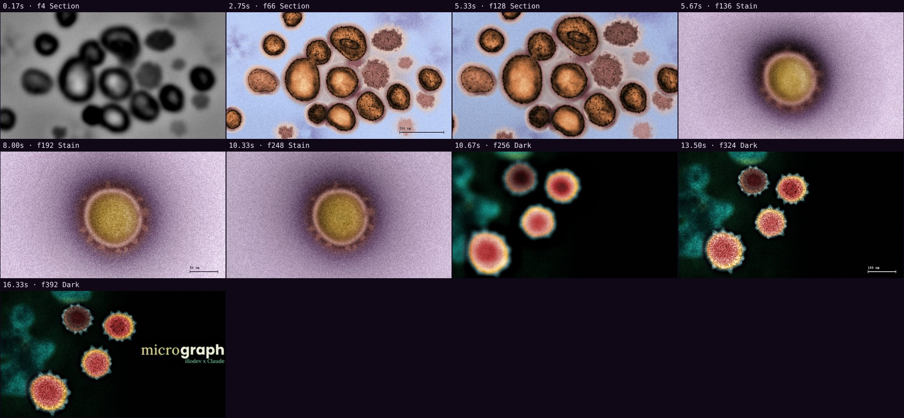

# Automatic review · sandbox/2026-11-17-micrograph-test/scene.js

960×540 px · 24 fps · 16.50 s · 396 frames

## Warnings

- **Flat frames** (a single color) at 0.00 s.

## Motion

Energy per second (how much the image changes):

```
▇▃▂▂▂█▄▄▄▄▇▂▂▂▂▂▃
0    5    10   15   
```

No still stretches of 1 s or more.

Large jumps outside cuts (can be normal in dense patterns; check whether they bother): 0.17 s, 0.33 s.

## Speed

Painting: 5651 ms/frame cold, 4374 ms warm → full render ≈ 1732 s at this size.

> Slow: cache static elements with `Motion.sprite` and lower the texture density.

## Contact sheet


