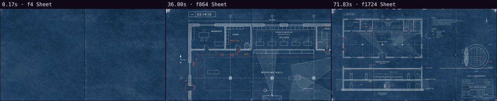

# Automatic review · sandbox/2026-11-17-the-plan/scene.js

960×540 px · 24 fps · 72.00 s · 1728 frames

## Warnings

- None.

## Motion

Energy per second (how much the image changes):

```
▁▂▄▅▅▃▁▁ ▁▂▁▁▁▄▆▃▁▁▁▁▁▆▄▁▂▆▄▁▁▁▁▁▂▂▂▂▂▂▂▂▂▁▁▁▁▁▆▆▅▂▃▂▄█▅▁▂▃▂▁▁▇▇▄▄▅▇▆▂▁▁
0    5    10   15   20   25   30   35   40   45   50   55   60   65   70   
```

Still stretches of 1 s or more (intended? a visual pause that looks like a glitch is a bug): 7.33 s–9.67 s, 69.33 s–71.83 s.

## Speed

Painting: 563 ms/frame cold, 29 ms warm → full render ≈ 50 s at this size.

## Contact sheet


