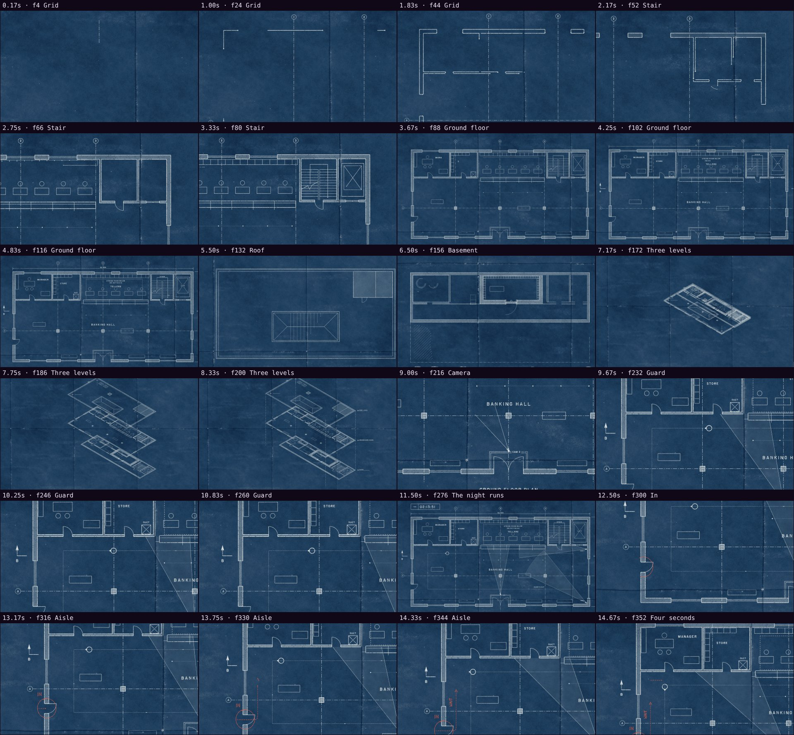
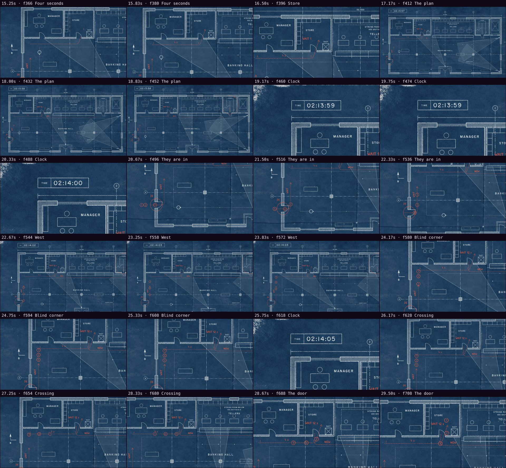
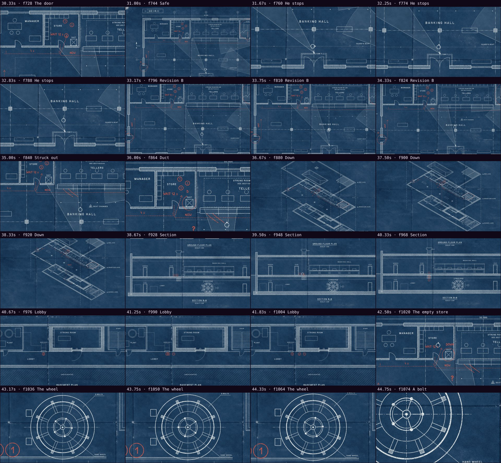
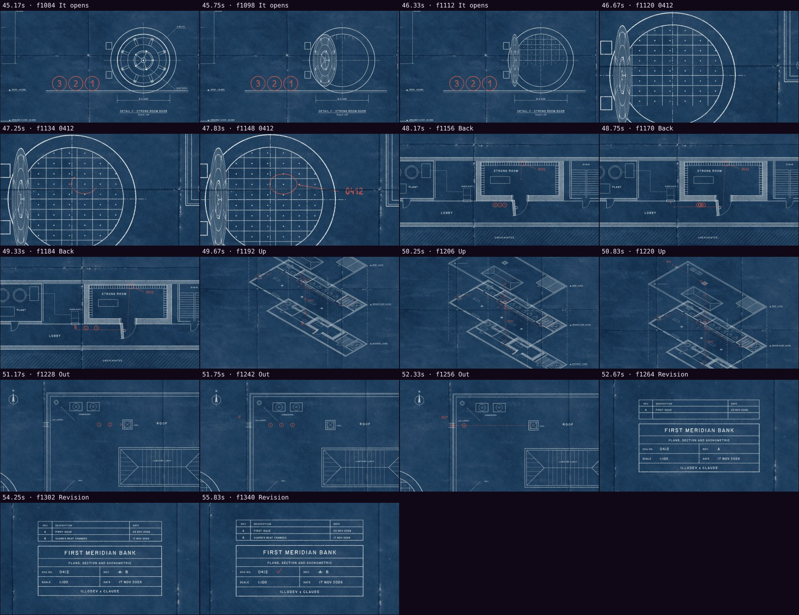

# Automatic review · sandbox/2026-11-17-the-plan/scene.js

960×540 px · 24 fps · 56.00 s · 1344 frames · 120 BPM

## Warnings

- None.

## Motion

Energy per second (how much the image changes):

```
▄▄▅▅▄▅▅▄▅▆▇▅▅▆▇█▆▃▅▄▆▆▅▅▅▆▄▇▇▅▅▅▆▆▆▇▇▇▇▆▇▆▆▆█▅▆▇▅▇▇▅▄▄▃▄
0    5    10   15   20   25   30   35   40   45   50   55   
```

No still stretches of 1 s or more.

## Speed

Painting: 773 ms/frame cold, 750 ms warm → full render ≈ 1007 s at this size.

> Slow: cache static elements with `Motion.sprite` and lower the texture density.

## Contact sheet





