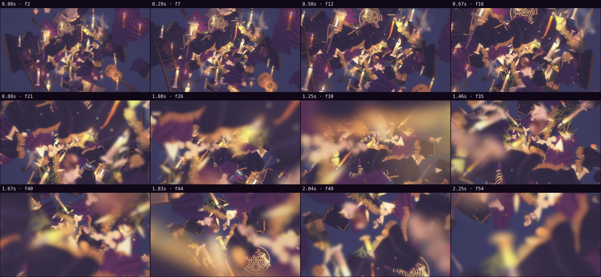

# Automatic review · sandbox/2026-11-19-souvenir-test/dev/darknight-loose/scene.js

960×540 px · 24 fps · 2.33 s · 56 frames

## Warnings

- None.

## Motion

Energy per second (how much the image changes):

```
▇█▇
0    
```

No still stretches of 1 s or more.

Large jumps outside cuts (can be normal in dense patterns; check whether they bother): 1.17 s, 1.33 s, 1.67 s, 1.83 s, 2.00 s.

## Speed

Painting: 7508 ms/frame cold, 5292 ms warm → full render ≈ 296 s at this size.

> Slow: cache static elements with `Motion.sprite` and lower the texture density.

## Contact sheet


