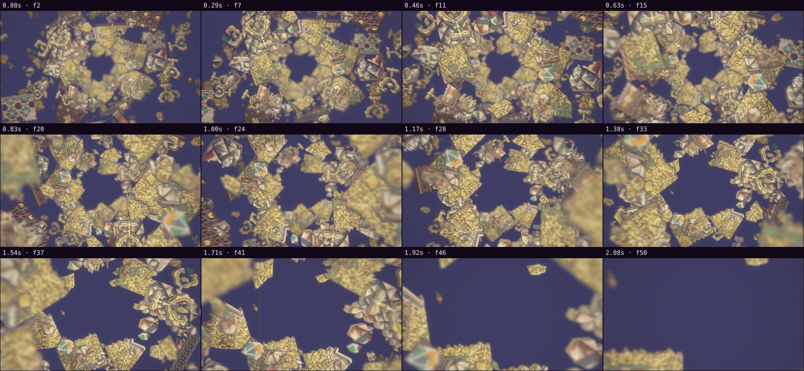

# Automatic review · sandbox/2026-11-19-souvenir-test/dev/dome-loose/scene.js

960×540 px · 24 fps · 2.17 s · 52 frames

## Warnings

- **Non-deterministic** at 0.42 s: the frame changes depending on what was painted before (leftover state, Math.random, Date, a badly keyed cache).

## Motion

Energy per second (how much the image changes):

```
██ 
0    
```

No still stretches of 1 s or more.

## Speed

Painting: 8221 ms/frame cold, 7628 ms warm → full render ≈ 397 s at this size.

> Slow: cache static elements with `Motion.sprite` and lower the texture density.

## Contact sheet


