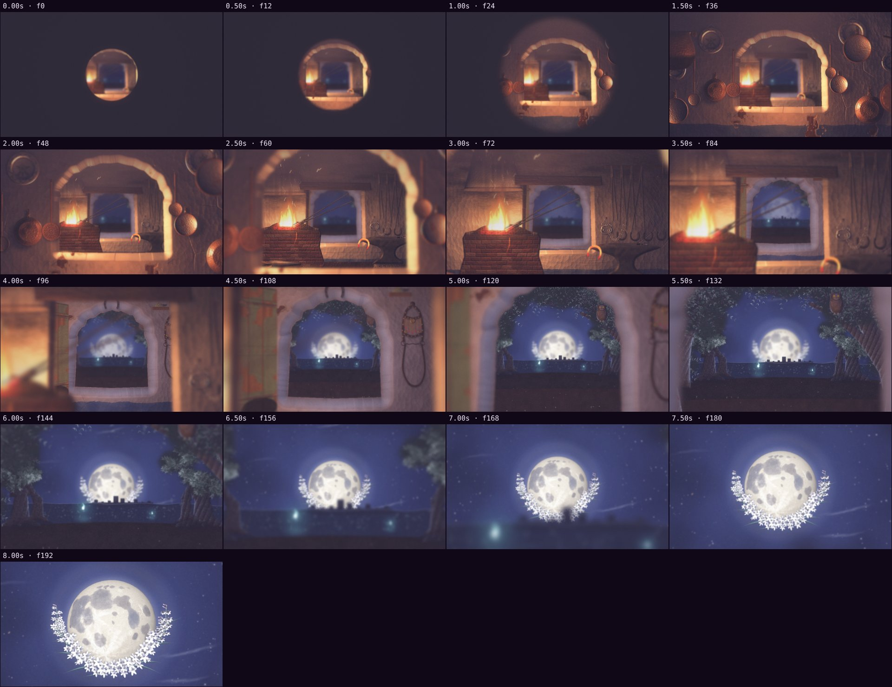

# Automatic review · sandbox/2026-11-19-souvenir-test/dev/forge/scene.js

960×540 px · 24 fps · 8.13 s · 195 frames

## Warnings

- None.

## Motion

Energy per second (how much the image changes):

```
▃▆█▆▇▆▄▅ 
0    5    
```

No still stretches of 1 s or more.

## Speed

Painting: 7512 ms/frame cold, 5246 ms warm → full render ≈ 1023 s at this size.

> Slow: cache static elements with `Motion.sprite` and lower the texture density.

## Contact sheet


