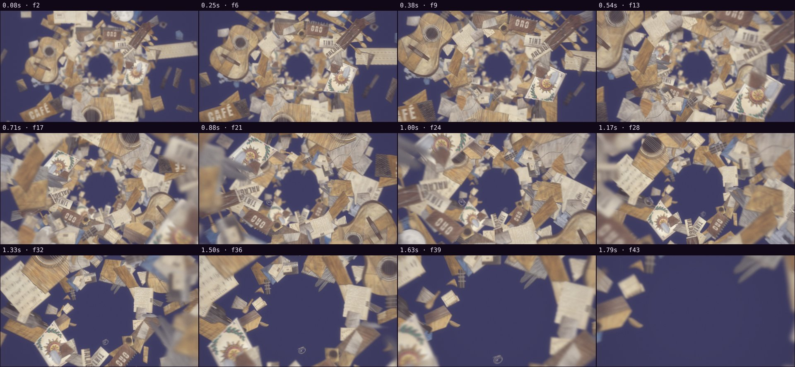

# Automatic review · sandbox/2026-11-19-souvenir-test/dev/planes-loose/scene.js

960×540 px · 24 fps · 1.88 s · 45 frames

## Warnings

- **Non-deterministic** at 0.38 s: the frame changes depending on what was painted before (leftover state, Math.random, Date, a badly keyed cache).

## Motion

Energy per second (how much the image changes):

```
██
0    
```

No still stretches of 1 s or more.

Large jumps outside cuts (can be normal in dense patterns; check whether they bother): 1.00 s, 1.33 s, 1.50 s, 1.67 s.

## Speed

Painting: 5981 ms/frame cold, 4799 ms warm → full render ≈ 216 s at this size.

> Slow: cache static elements with `Motion.sprite` and lower the texture density.

## Contact sheet


