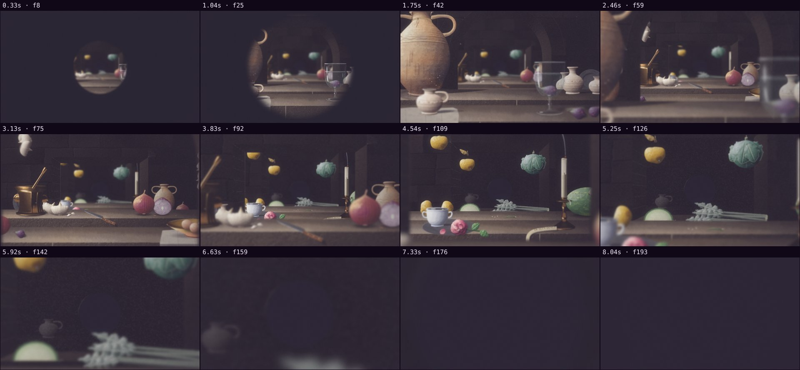

# Automatic review · sandbox/2026-11-19-souvenir-test/dev/stilllife/scene.js

960×540 px · 24 fps · 8.38 s · 201 frames

## Warnings

- **Flat frames** (a single color) at 7.00 s, 7.17 s, 7.33 s, 7.50 s, 7.67 s, 7.83 s….

## Motion

Energy per second (how much the image changes):

```
▃████▇▄▂▁
0    5    
```

No still stretches of 1 s or more.

## Speed

Painting: 5361 ms/frame cold, 4604 ms warm → full render ≈ 925 s at this size.

> Slow: cache static elements with `Motion.sprite` and lower the texture density.

## Contact sheet


