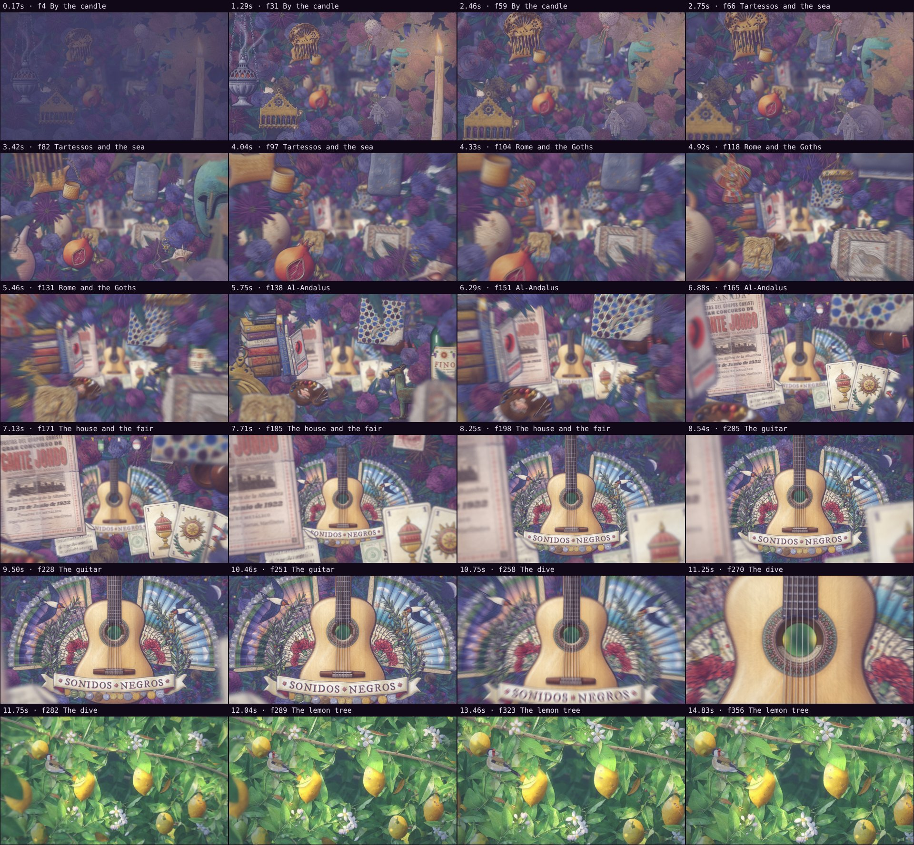

# Automatic review · sandbox/2026-11-19-souvenir-test/scene.js

960×540 px · 24 fps · 15.00 s · 360 frames

## Warnings

- None.

## Motion

Energy per second (how much the image changes):

```
▃▄▅▅▅▆▆▆▆▅▇█▅▄▂
0    5    10   
```

No still stretches of 1 s or more.

Large jumps outside cuts (can be normal in dense patterns; check whether they bother): 11.33 s, 11.50 s.

## Speed

Painting: 9315 ms/frame cold, 695 ms warm → full render ≈ 250 s at this size.

> Slow: cache static elements with `Motion.sprite` and lower the texture density.

## Contact sheet


