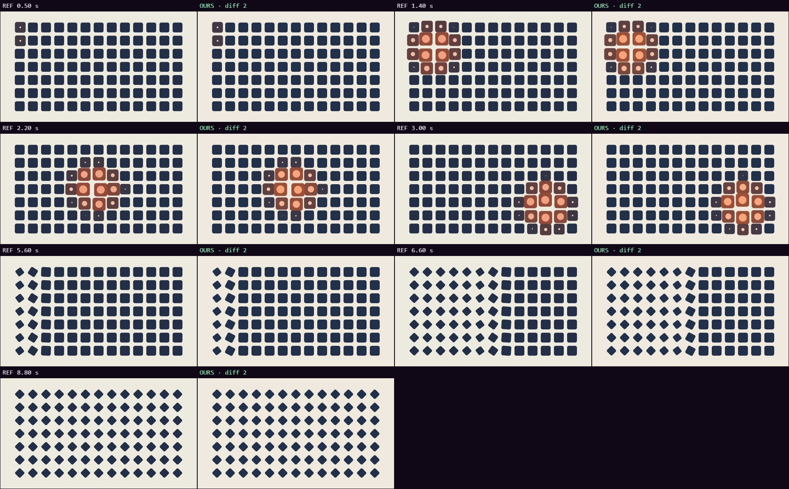

# Comparison with the reference · sandbox/2026-11-21-ae-field-effector/scene.js

Reference: `ae-field-effector.mp4` · mean difference **2.1** (0 = identical, <30 similar, >60 something else)

| Second | Difference |
|---|---|
| 0.50 | 2.1 |
| 1.40 | 2.2 |
| 2.20 | 2.1 |
| 3.00 | 2.2 |
| 5.60 | 2.3 |
| 6.60 | 2.4 |
| 8.80 | 1.7 |

