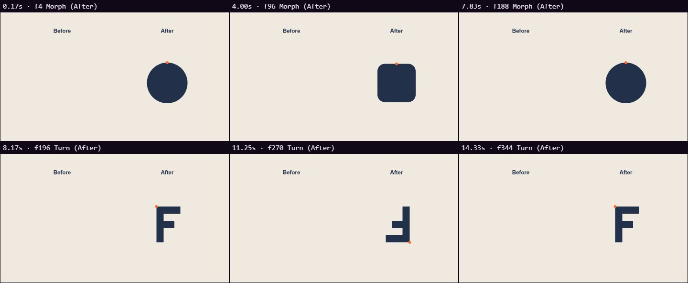

# Automatic review · sandbox/2026-11-21-ae-morph-fixer/scene.js

960×540 px · 24 fps · 14.50 s · 348 frames

## Warnings

- None.

## Motion

Energy per second (how much the image changes):

```
▃▅▄▄▄▂▄▇▆▆█▆▆█ 
0    5    10   
```

Still stretches of 1 s or more (intended? a visual pause that looks like a glitch is a bug): 5.17 s–6.33 s.

## Speed

Painting: 2 ms/frame cold, 1 ms warm → full render ≈ 0 s at this size.

## Contact sheet


