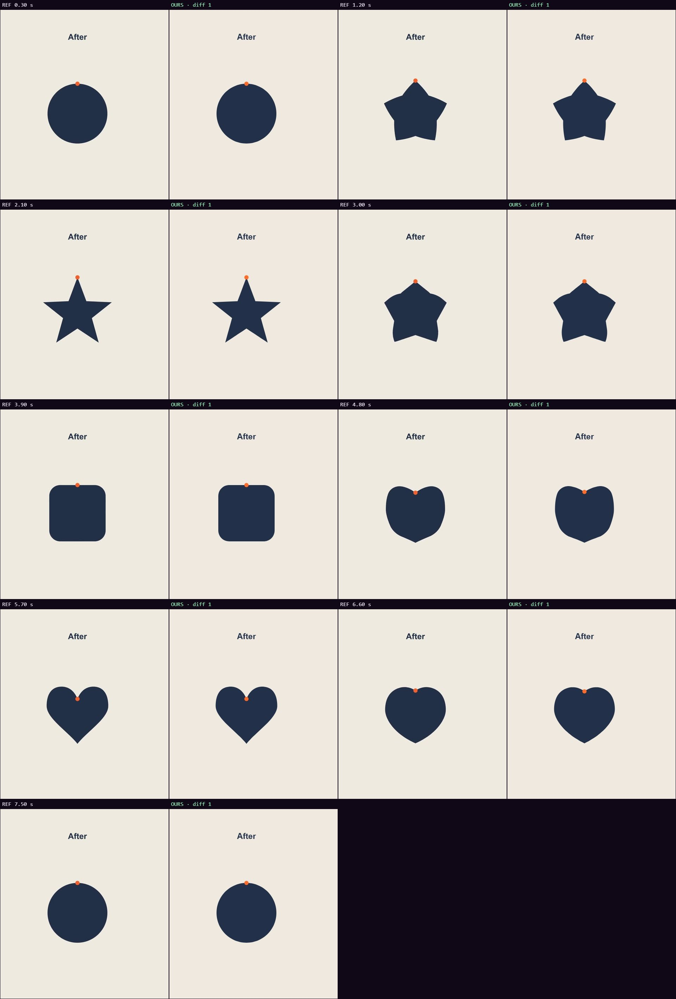

# Comparison with the reference · sandbox/2026-11-21-ae-morph-fixer/scene.js

Reference: `ae-morph-fixer.mp4` · mean difference **1.1** (0 = identical, <30 similar, >60 something else)

| Second | Difference |
|---|---|
| 0.30 | 1.1 |
| 1.20 | 1.1 |
| 2.10 | 1.1 |
| 3.00 | 1.1 |
| 3.90 | 1.1 |
| 4.80 | 1.3 |
| 5.70 | 1.1 |
| 6.60 | 1.3 |
| 7.50 | 1.1 |

