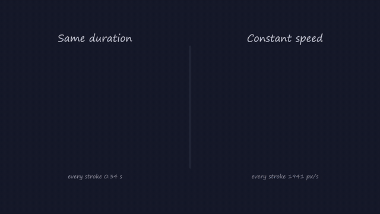

# Constant Speed Draw-On (After Effects)



Keying every Trim Paths End 0 → 100 % over the same time makes a 26 px tick crawl and a
2,650 px lasso race (left). **`Constant Speed Draw-On.jsx`** draws every stroke at one
speed in pixels per second, however long it is (right), and keeps everything on one
controls layer you can art-direct live.

## Install and use

1. In After Effects: **File › Scripts › Run Script File…** and pick
   `Constant Speed Draw-On.jsx`. A small panel floats; click **?** › **Install as a panel**
   and restart After Effects to dock it from the **Window** menu (no admin rights needed).
2. Select shape layers, groups, paths or Trim Paths (Illustrator artwork converted to
   shapes works as it is) and click **Apply**.
3. A **Draw-On Controls** layer appears. Set everything in its Effect Controls; nothing
   needs re-running. Edited a path? Click **Update**. **Remove** gives back what was there.

| Control | What it does |
|---|---|
| Speed (px per second) | The pen speed, the same for every stroke as seen in the comp (layer and group scale, parents and 3D cameras included) |
| Fit to duration, Duration | Ignore Speed: the speed at which the whole drawing lasts Duration |
| Start time | When drawing starts (Apply sets it to the current time) |
| Timing | **Together** (all start at once, short strokes finish first) · **One after another** (a pen, with **Gap**; below 0 they overlap) · **Stagger** (a stroke starts every **Stagger** seconds) · **My own start times** (each stroke starts at the first key of its own Trim Paths: move the key to move the stroke) |
| Order | Layer order, reverse, left to right, right to left, top to bottom, bottom to top, center out, outside in, random |
| Direction | As drawn, reversed, or following the order (lines run left to right when the order does) |
| Ease each stroke, Ease whole drawing | 0 % = exactly constant. The whole-drawing ease slows the start and end of the drawing while every stroke still moves at the same speed as the others |
| Afterwards, Hold | Stay drawn, **Draw off** (the lines leave the way they came in) or **Rewind** (the drawing plays backwards), after Hold |
| Speed used, Drawing time | Computed: read them, leave them |

What counts as a stroke: each group that holds paths (a letter with holes is one stroke:
outline, then holes, at the same speed). A selected Trim Paths is one stroke as it is, for
example one Trim Paths over a whole layer. Your own Trim Paths, keys and expressions stay
(the rig's expressions override them; Remove gives them back). A Trim Paths above the
strokes is switched off, not deleted, after a warning (Cancel is the default).

Apply with the controls layer selected adds the selection to that rig; without it, Apply
makes a new rig (`Draw-On`, `Draw-On 2`…). Undo with Ctrl/Cmd+Z.

**Limits:** lengths are measured at the current time (an animated path, scale or camera is
measured as it is then: Update re-measures). Operators before the trim (Merge, Offset,
Zig Zag, Wiggle…) and a rounded Polystar make the length approximate; Apply says so.

## How it works

Measured in After Effects 27 before anything was built (`probe/`):

- **Trim Paths cuts by arc length** (to 0.05 px, even on handles that make the bezier very
  uneven), so a linear End is already a constant speed inside one path. The rig only gives
  each stroke `length / speed` seconds and a start time.
- **"Individually" runs through the paths by length, top to bottom,** counting each path's
  length in its own group, before that group's scale (a root trim over a group scaled
  200 % gives it its unscaled share).
- **AE's shape-group transform** is `Position + R(rotation) · K(skew) · S(scale) · (p −
  Anchor)` with `K = R(−axis) · [[1, −tan skew], [0, 1]] · R(axis)`: reproduced to 0.000 px.
- Rectangles start at the top-right corner (below it when rounded), ellipses and stars at
  the top, all clockwise; Shape Direction 3 reverses them (1 and 2 don't).

So the script measures every stroke **in comp pixels**: each path through its groups'
transforms, then the layer's `toComp` (one temporary text layer whose expression places
three points per stroke; every sample point for 3D layers, whose camera has perspective).
A stroke in a stretched or skewed group would draw faster along its long side: it carries
a 65-point table that keeps the visual speed even (0.24 % of its length off at worst,
10.8 % without it).

Lengths, ranks in the nine orders and directions are **baked** into each stroke's Start and
End expressions (cheap per frame); the sliders are **live**. The expressions find the
controls through a Layer Control on each rigged layer (renaming a layer from a script does
not update expressions that name it), and show the stroke whole if the controls are gone.

## Files

| File | What it is |
|---|---|
| `Constant Speed Draw-On.jsx` | **The tool** (built: don't edit) |
| `drawon-time.js` | When each stroke draws, per frame (ES3): pasted into every expression, run by the tests and the preview |
| `drawon-geom.js` | Measuring: AE's group transform, its parametric shapes, lengths, the stretch table, the orders (ES3) |
| `drawon-ae.jsx` | The After Effects half: finding strokes, the toComp probe, the controls layer, expressions, Apply/Update/Remove, the panel and its guide |
| `build.mjs` | Joins them into the tool and lints for ES3 (including nested `?:`, which ExtendScript misreads) and display-name lookups; writes a test build to `out/` |
| `test.mjs` | Node: 2,931 checks: constant speed in every mode (finite differences), Fit, ease, draw-off and rewind; geometry against AE's measurements; the expressions the tool writes run in a mock of AE |
| `make-demo.jsx` | Builds the demo in AE; in test mode it also measures the pen speed in AE itself and tests Update, Remove, the warning and the panel (`review/ae-log.txt`) |
| `ae-bridge.jsx` | The test runner that stays inside AE for a session (from the morph fixer) |
| `probe/` | The AE measurements the rig rests on (`trim-probe*.jsx` → `trim-probe*.txt`, checked by `fit.mjs`) |
| `art/make-spec.mjs` → `demo-spec.js` | The demo drawing: "draw" in Patrick Hand (OFL), a swash, a lasso, sparkles, a star |
| `scene.js` | Engine preview of the demo, timed by the same `drawon-time.js` |

```bash
node sandbox/2026-11-23-ae-draw-on-rig/build.mjs && node sandbox/2026-11-23-ae-draw-on-rig/test.mjs
# AE test: send ae-bridge.jsx once (AfterFX.exe -ro), then drop probe/run-demo.jsx into out/ae/bridge/inbox/
```

**Tested in AE 27** (`review/ae-log.txt`): straight lines in a plain, a 50 % scaled, a
150 × 70 % turned, a parented, a skewed-group, a 3D-perspective and a two-path layer all
draw at 300 px/s within 0.11 %, measured from the trimmed layers' boxes; lengths match the
spec composed in plain math to 0.000 %; Update with nothing moved rewrites nothing; the
designer's keys, trims and switches come back with Remove. AE's render matches the engine
preview frame for frame (mean difference 1–2.8 levels, antialiasing).
