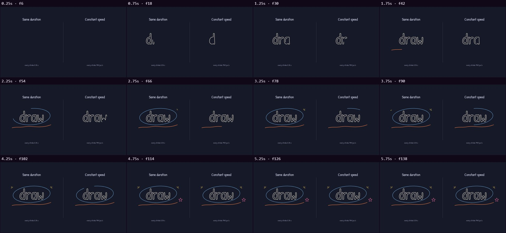

# Automatic review · sandbox/2026-11-23-ae-draw-on-rig/scene.js

960×540 px · 24 fps · 6.00 s · 144 frames

## Warnings

- None.

## Motion

Energy per second (how much the image changes):

```
▅█▆▄▃ 
0    5    
```

Still stretches of 1 s or more (intended? a visual pause that looks like a glitch is a bug): 0.00 s–1.33 s, 1.50 s–5.83 s.

## Speed

Painting: 3 ms/frame cold, 2 ms warm → full render ≈ 0 s at this size.

## Contact sheet


