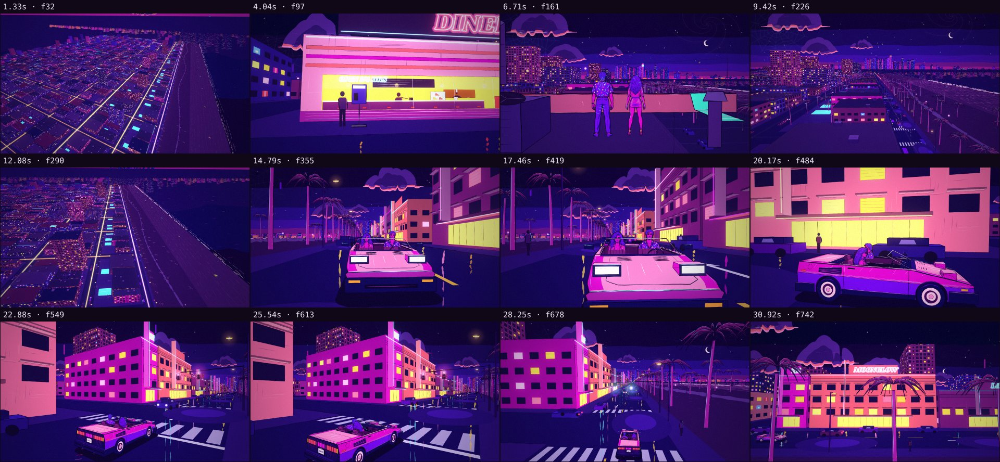

# Automatic review · sandbox/2026-11-24-run-away-with-me/dev/clouds/scene.js

960×540 px · 24 fps · 32.27 s · 774 frames · 119 BPM

## Warnings

- None.

## Motion

Energy per second (how much the image changes):

```
█▇▇▆█▆▆▃▆▆▆▅▆▇▆▅▆▆█▇▆▄▅▄▅▃▅▅▆▃▅▆▃
0    5    10   15   20   25   30   
```

No still stretches of 1 s or more.

Large jumps outside cuts (can be normal in dense patterns; check whether they bother): 4.17 s, 6.17 s, 14.17 s, 18.33 s, 22.33 s, 26.33 s.

## Speed

Painting: 433 ms/frame cold, 300 ms warm → full render ≈ 232 s at this size.

## Contact sheet


