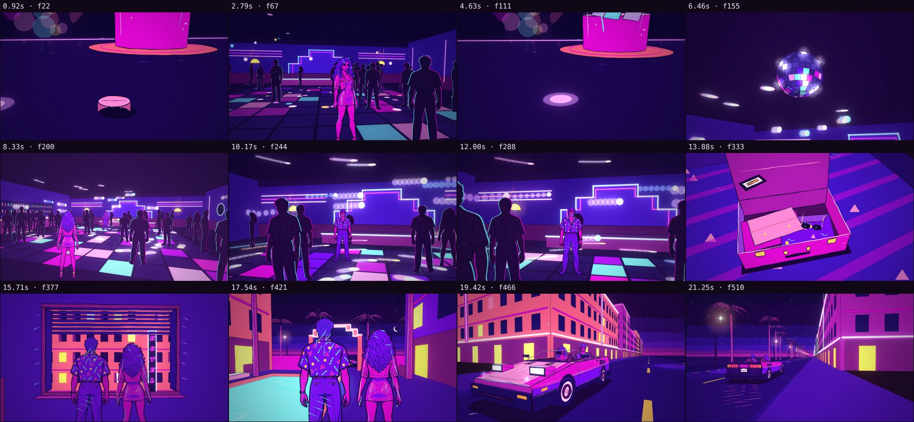

# Automatic review · sandbox/2026-11-24-run-away-with-me/dev/escape/scene.js

960×540 px · 24 fps · 22.18 s · 532 frames · 119 BPM

## Warnings

- **Transparent holes** (the empty canvas shows through: a background that doesn't cover the camera, or nothing painted) at 3.00 s (0.3 %), 9.17 s (0.3 %), 10.50 s (0.3 %), 12.17 s (0.8 %), 12.33 s (0.8 %), 12.50 s (0.8 %)….

## Motion

Energy per second (how much the image changes):

```
▃▃▆▄▄▃▅▃█▆▇▇▅▄▄▄▇▆▆▄▅▃ 
0    5    10   15   20   
```

No still stretches of 1 s or more.

Large jumps outside cuts (can be normal in dense patterns; check whether they bother): 8.17 s, 10.17 s, 16.17 s, 18.17 s, 20.17 s.

## Speed

Painting: 73 ms/frame cold, 51 ms warm → full render ≈ 27 s at this size.

## Contact sheet


