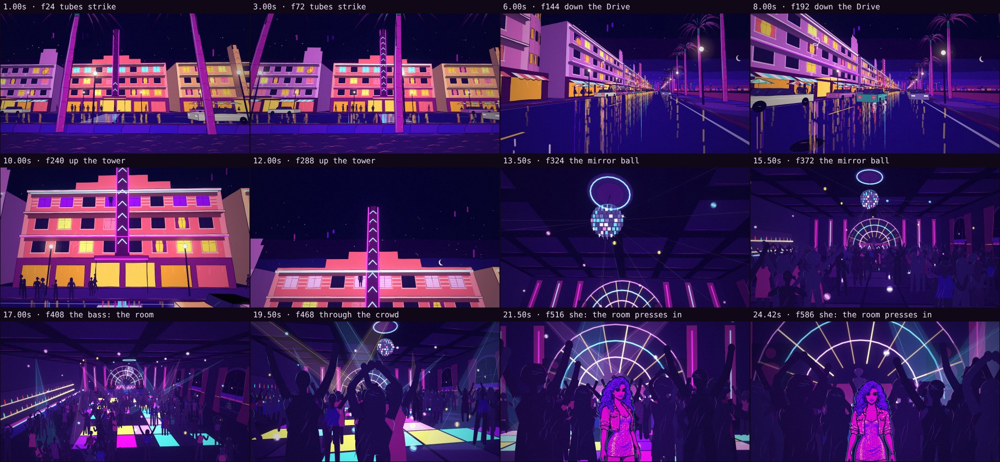

# Automatic review · sandbox/2026-11-24-run-away-with-me/dev/opening/scene.js

960×540 px · 24 fps · 24.62 s · 591 frames · 119 BPM

## Warnings

- **Transparent holes** (the empty canvas shows through: a background that doesn't cover the camera, or nothing painted) at 0.00 s (0.8 %), 0.17 s (0.8 %), 0.33 s (0.8 %), 0.50 s (0.8 %), 0.67 s (0.8 %), 0.83 s (0.8 %)….

## Motion

Energy per second (how much the image changes):

```
▃▅▅▄▄▅▆▅▅██▅▄▄▅▄▅▅▅▆▅▅▅▅▅
0    5    10   15   20   
```

No still stretches of 1 s or more.

Large jumps outside cuts (can be normal in dense patterns; check whether they bother): 9.83 s, 10.00 s, 10.17 s, 10.33 s, 10.50 s.

## Speed

Painting: 291 ms/frame cold, 298 ms warm → full render ≈ 176 s at this size.

## Contact sheet


