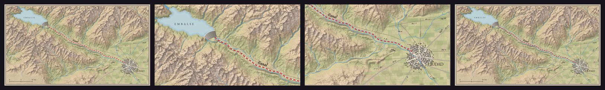

# Atlas



A page of a fine early-20th-century school atlas, drawn from a heightfield: Swiss shaded relief lit from the upper left, colours read from a table of (tint elevation × shade) measured on the reference plate (green valleys, cream lights, violet-grey shadows, brown heights), dense warm-brown contour lines, gullies that appear as the camera comes closer, blue rivers and a lake with waterlines, a red dashed route, a radial town, field parcels, EB Garamond lettering and a ruled frame. The relief is WebGL2; the ink on top is canvas in map pixels, so it stays on the ground as the camera moves. Real terrain (an open DEM) renders crisp in it.

**Status:** in testing · **Skill:** [`style-atlas`](../../.claude/skills/style-atlas/SKILL.md) (the rules and the checklist that keep every video in the style consistent)

## Start a video in this style

```bash
node engine/new.mjs my-test --style atlas --duration 4
npm run preview    # http://127.0.0.1:5173
```

`template.js` is the minimal scene `new.mjs` copies.

## Files

| File | What it gives |
|---|---|
| `template.js` | a few seconds showing the style in miniature |
| `atlas.js` | `Atlas`: `load` (uint16 heights and tint), `relief` (the shaded relief, its tints, contours, gullies and paper), `onMap`, and the ink: `lake`, `river`, `channel`, `dashed`, `road`, `town`, `village`, `fields`, `dam`, `label`, `scaleBar`, `neatline`, `along`, `inside`; the measured palette `SWISS` and inks `INK` |
| `erode.js` | `AtlasErode.erode`: stream-power erosion (FastScape) to carve a heightfield into ridges and valleys |
| `sample.js` | `AtlasSample`: a 480 × 270 piece of the test's plate (heights, tint, shore, canal, rivers) |

## Made with it

- [atlas-test](../../sandbox/2026-11-17-atlas-test/) · the style test: the plate matched to its reference, then the water runs down the canal from the dam to the town
