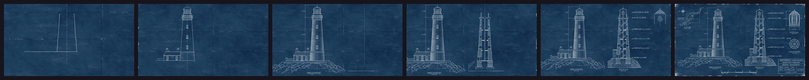

# Blueprint



A drawing office's cyanotype. One sheet of Prussian blue that has been folded and handled,
and white line work that is drafted in front of the viewer in the order a draughtsman sets
it out: axes and ground, outlines, hatching, dimensions, lettering. The print is one scalar
through one measured ramp (blue → bare sheet), so wear and ink are the same thing in
different amounts; the ink goes down on its own layer, broken by the paper's tooth, with a
soft bleed. Views agree with each other because the object is drawn once, in real units.
For engineering, architecture, machines, products explained by how they are built, and
serious or institutional pieces.

**Status:** approved · **Skill:** [`style-blueprint`](../../.claude/skills/style-blueprint/SKILL.md) (the rules and the checklist that keep every video in the style consistent)

## Start a video in this style

```bash
node engine/new.mjs my-test --style blueprint --duration 4
npm run preview    # http://127.0.0.1:5173
node engine/render.mjs sandbox/<exp>/scene.js --size 1920
```

`template.js` is the minimal scene `new.mjs` copies.

## Files

| File | What it gives |
|---|---|
| `template.js` | a pipe flange drafts itself: centre lines, plan, a hatched section, a dimension, its title |
| `blueprint.js` | `Blueprint`: the sheet (`paper`: exposure clouds, weave, creases, worn edges, and the tooth mask), a display list that drafts in order (`drawing`: pens, lines, arcs, freehand curves, hatch, stipple, graded washes, lettering), the conventions (`arrow`, `dimV`, `dimH`, `level`, `title`) and the print (`frame`: sheet, camera, ink through the tooth, bleed) |

Font: Routed Gothic (`fonts/RoutedGothic.ttf`, SIL OFL 1.1, by Darren Embry).

## Made with it

| Video | What it is |
|---|---|
| [blueprint-test](../../sandbox/2026-11-17-blueprint-test/) | the style test: the general arrangement of a lighthouse drafts itself (elevation, section, optic, plan, site plan, title block), 14 s |
