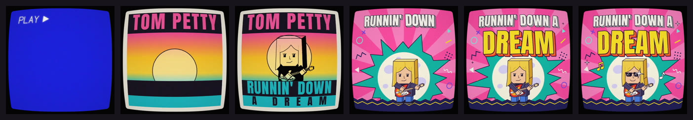

# '90s cereal commercial



A Saturday-morning TV spot taped on VHS and played on a CRT: flat cel colour with an even
dark outline, box characters in oblique projection, spinning sunbursts, jagged starbursts,
Memphis shapes, chunky extruded letters that hop on the beat, and a tape-and-tube finish
measured on a reference (the glass, the chroma smear, the tracking, `PLAY ▶` on blue).

**Status:** approved · **Skill:** [`style-cereal-ad`](../../.claude/skills/style-cereal-ad/SKILL.md) (the rules and the checklist that keep every video in the style consistent)

## Start a video in this style

```bash
node engine/new.mjs my-test --style cereal-ad --aspect 1:1 --duration 6
npm run preview    # http://127.0.0.1:5173
```

`template.js` is the minimal scene `new.mjs` copies.

## Files

| File | What it gives |
|---|---|
| `template.js` | the tape starts on blue, then a title card: sunburst, starburst, a box that lands, a word that pops letter by letter |
| `cereal.js` | `Cereal`: sunbursts and starbursts, Memphis shapes, sparkles and notes, oblique boxes, prisms and drums, extruded lettering, the VCR's display, and the tape-and-tube finish (one WebGL pass) |

## Made with it

- [runnin-down-a-dream](../../sandbox/2026-11-11-runnin-down-a-dream/) · the opening of a videoclip for Tom Petty's «Runnin' Down a Dream» (style test) · [mp4](../../sandbox/2026-11-11-runnin-down-a-dream/render/runnin-down-a-dream.mp4)
