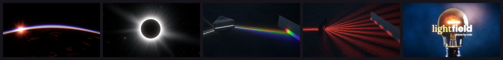

# Lightfield



Light photographed, not drawn. A scene is a fragment shader that says how much light leaves
each point (a sun at 1500, a filament at 500, a wall at 0.1), and the kit is the camera in
front of it: a lens that scatters (bloom over seven octaves, the wide ones tinted like film
halation), an iris that throws rays off anything bright enough, chromatic aberration, a film
curve that burns highlights to white, and grain that follows the signal. Titles are emitted
as light through the same lens. For science, space, physics and «cinematic» title cards.

**Status:** in testing · **Skill:** [`style-lightfield`](../../.claude/skills/style-lightfield/SKILL.md) (the rules and the checklist that keep every video in the style consistent)

## Start a video in this style

```bash
node engine/new.mjs my-test --style lightfield --duration 4
npm run preview    # http://127.0.0.1:5173
node engine/render.mjs sandbox/<exp>/scene.js --size 1920
```

`template.js` is the minimal scene `new.mjs` copies.

## Files

| File | What it gives |
|---|---|
| `template.js` | a point of light heats up in a dusty blue room and lights the title |
| `lightfield.js` | `Lightfield`: scenes as radiance (`radiance(p)` in GLSL, with `emit`, `blackbody`, `motes`, `plate`) and the camera (HDR target, bloom pyramid with halation, iris rays, aberration, vignette, toe and film curve, grain) |

## Made with it

| Video | What it is |
|---|---|
| [lightfield-test](../../sandbox/2026-11-16-lightfield-test/) | the style test, grown into a short piece: five lights from the sky to the bench (the Sun over the Earth's limb, a total eclipse, a prism, two slits one photon at a time, a filament and the title; 30.5 s, the first and last shots matched to the user's reference stills) |
