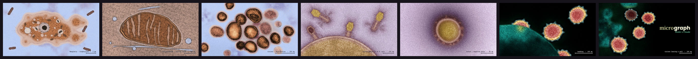

# Micrograph



An image made by an instrument and tinted afterwards. A scene is a fragment shader that
describes a specimen: for every point, how much signal the detector gets (one grey value)
and which ink the colourist laid over that region. The kit is the instrument and the
colourist: structures that are soft with grain that is not, a focus that hunts, shot noise
that follows the signal, and false colour as a ramp black → ink → light with the ink's
edges softer than the signal's. For biology, microscopy and «scientific image» inserts;
three measured palettes (orange on pale blue, olive and rose on lilac, red, yellow and teal
on black).

**Status:** in testing · **Skill:** [`style-micrograph`](../../.claude/skills/style-micrograph/SKILL.md) (the rules and the checklist that keep every video in the style consistent)

## Start a video in this style

```bash
node engine/new.mjs my-test --style micrograph --duration 4
npm run preview    # http://127.0.0.1:5173
node engine/render.mjs sandbox/<exp>/scene.js --size 1920
```

`template.js` is the minimal scene `new.mjs` copies.

## Files

| File | What it gives |
|---|---|
| `template.js` | two particles in a pool of stain: found out of focus, pulled in, tinted by a wash, with a scale bar |
| `micrograph.js` | `Micrograph`: scenes as a specimen (`specimen(p, s, ink)` in GLSL, plus `grit`; helpers `grainy`, `body`, `crown`, `lumps`, `shell`, `smin`, `datum`, `plate`) and the instrument (softening, defocus with its fringe, shot noise per exposure, gain, ink bleed, the colour ramp), and `databar` (scale bar and caption) |

## Made with it

| Video | What it is |
|---|---|
| [micrograph-test](../../sandbox/2026-11-17-micrograph-test/) | the style test, grown into a piece: seven specimens from the largest to the smallest, cut as changes of magnification (an amoeba, a mitochondrion in serial sections, a phage emptying into a bacterium and virions budding are ours; three shots are matched to the user's reference stills; 37.5 s) |
