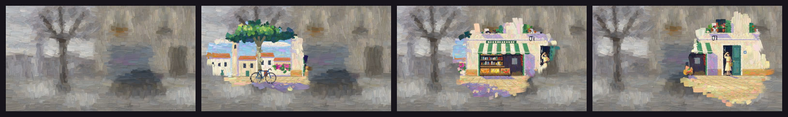

# Oil



Oil paint on canvas: brush strokes of thick paint laid coarse to fine over a flat study,
each with its bristle tracks, rails and dry ends, lit from the top left; broken colour and
violet-blue shadows after Monet. Two brushes can share one canvas: a loose, out-of-focus
picture and a finished one that appears where the eye rests.

**Status:** in testing · **Skill:** [`style-oil`](../../.claude/skills/style-oil/SKILL.md) (the rules and the checklist that keep every video in the style consistent)

## Start a video in this style

```bash
node engine/new.mjs my-test --style oil --aspect 16:9 --duration 6
npm run preview    # http://127.0.0.1:5173
```

`template.js` is the minimal scene `new.mjs` copies.

## Files

| File | What it gives |
|---|---|
| `template.js` | a field of poppies under a tree, loosely brushed; the eye crosses it and finishes the picture where it rests |
| `oil.js` | `Oil`: the study (a flat picture plus brush directions), `lay` (strokes decided from the study, coarse to fine, with broken colour), the surface (bristles, relief, light), a painting with a base picture and one repaint per drawing, and `focus` (the strokes that exist around a gaze) |

## Made with it

- [oil-test](../../sandbox/2026-11-12-oil-test/) · an old man who has lost the centre of his sight looks across a winter square, and the summer of 1974 is painted back wherever his eye rests · [mp4](../../sandbox/2026-11-12-oil-test/render/oil-test.mp4)
