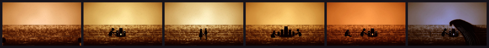

# Sand



Sand animation on a light table: warm light from below, thick sand near black, thin sand
breaking into single amber grains, finger lines as channels of light with the displaced
sand piled on their rims, heaps poured from the fist, silhouettes with details scratched
out, and no cuts: a palm (or a crest of sand) sweeps the old picture away and leaves the
next one behind it.

**Status:** in testing · **Skill:** [`style-sand`](../../.claude/skills/style-sand/SKILL.md) (the rules and the checklist that keep every video in the style consistent)

## Start a video in this style

```bash
node engine/new.mjs my-test --style sand --aspect 16:9 --duration 6
npm run preview    # http://127.0.0.1:5173
```

`template.js` is the minimal scene `new.mjs` copies.

## Files

| File | What it gives |
|---|---|
| `template.js` | a dune and the sea in sand, a gull drawn with a finger, a poured sun, a palm sweep |
| `sand.js` | `Sand`: the table (a density canvas turned into light per pixel: grain coverage, per-channel transmission and vignette), masses, trickles, heaps, loose grains, finger channels, presses, palm wipes, striations, the sweep, and the light by time of day |

## Made with it

- [tide](../../sandbox/2026-11-04-tide/) · «Marea»: one life on one beach, each wave the artist's palm · [mp4](../../sandbox/2026-11-04-tide/render/tide.mp4)
