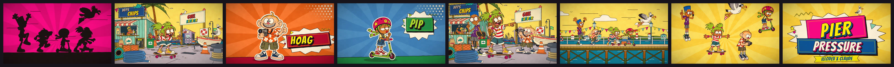

# Skate toon



The look of a late-'90s extreme-sports TV cartoon: a thin, even, hand-held black line, flat
saturated colour with no shading under a yellow sky, kids with huge heads, goggle eyes and
wide toothy mouths in clothes far too big, chunky boots, fat-fingered hands, sets in crooked
perspective with loose tick marks. Characters and places are always our own.

**Status:** approved · **Skill:** [`style-skate-toon`](../../.claude/skills/style-skate-toon/SKILL.md) (the rules and the checklist that keep every video in the style consistent)

Model sheet of its first cast: [`sandbox/2026-11-14-pier-pressure/review/cast.jpg`](../../sandbox/2026-11-14-pier-pressure/review/cast.jpg).

## Start a video in this style

```bash
node engine/new.mjs my-test --style skate-toon --duration 4
npm run preview    # http://127.0.0.1:5173
```

`template.js` is the minimal scene `new.mjs` copies.

## Files

| File | What it gives |
|---|---|
| `template.js` | Kit rides in along a sea wall, stops pointing the way and is off again; a palm, a hand-lettered sign, the broadcast finish |
| `drawn.js` | `Drawn`: runs a character's drawings written as code (shapes of control points, strokes with a width and a colour, grouped in parts): `def`, `draw` (parts moved, hidden or alone, a sticker's edge, blinks), `meta`, `parts` |
| `cast/` | two of Kit's sheets as drawings in code (her pushing cycle; push, glide, point), for the template. A cast is made per film: sheets on a green ground, read into code by the tools in [`sandbox/2026-11-14-pier-pressure/tools/`](../../sandbox/2026-11-14-pier-pressure/tools/) |
| `toon.js` | `SkateToon`: the palette, the hand-held line, flat shapes, one-skin unions, ribbons, set pieces whose corners overshoot, tick marks, glass, palms, sign lettering, the hand chart |
| `tv.js` | `SkateToonTV.post`: the broadcast finish for a scene's `post` (painted fills, film weave and grain, standard-definition softness, warm lifted blacks), each part with its own amount |
| `kid.js` | `SkateKid`: a figure built from a spec and a pose. Kept for stand-ins and blocking only: characters designed this way were rejected («dibujos muy prematuros»); a character that will be seen comes from a sheet |

Font: [Bangers](../../fonts/OFL-Bangers.txt), SIL OFL 1.1.

## Made with it

- [pier-pressure](../../sandbox/2026-11-14-pier-pressure/) · «Pier Pressure», the opening of a cartoon that never existed (style test) · [mp4](../../sandbox/2026-11-14-pier-pressure/render/pier-pressure.mp4)
