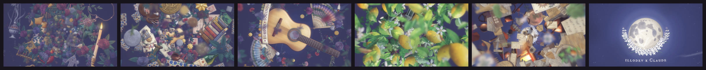

# Souvenir



A place told through its painted emblems, in the manner of tattoo flash, cigar-box and
fruit-crate labels and holiday postcards. Every piece is opaque paint modelled with light:
emblem pieces with a blue-black contour and airbrushed shade, still lifes in brush strokes
with no line at all, gold, ribbons with lettering. A film is a flight through such things,
each floating loose at its own depth, and its only actor is the camera, which dives down
its axis ever faster, rolling as it goes: what is near smears and goes out of focus, the
lights glow, the blacks are lifted. For emblems, allegories of a place or a culture,
painted labels, studio idents and any «infinite zoom» through paintings.

**Status:** approved · **Skill:** [`style-souvenir`](../../.claude/skills/style-souvenir/SKILL.md) (the rules and the checklist that keep every video in the style consistent)

## Start a video in this style

```bash
node engine/new.mjs my-test --style souvenir --duration 4
npm run preview    # http://127.0.0.1:5173
node engine/render.mjs sandbox/<exp>/scene.js --size 1920
```

`template.js` is the minimal scene `new.mjs` copies.

## Files

| File | What it gives |
|---|---|
| `template.js` | a gilt seal on a crimson night and a dive through its eye into a bunch of grapes: two pictures, the two manners, one camera |
| `souvenir.js` | `Souvenir`: the brush manner (`form`: a piece painted per pixel as a lit volume, with strokes, sheen, a broken edge; `put`, `cast`, `dab`), the emblem manner (`piece`: contour + airbrush; `spray`, `ink`, `textOn`), things on their own sheet (`sheet`, `sprayIn`, `stamp`, `reliefField`, `frame`), `tooth` (the board's grain) and `brushwork` (the hand in the paint), the dive (`rig`: layers at depths, depth of field, an open shutter, `loose` pieces cut to their paint that turn and drift on their own; `flight`: a camera that gathers speed and rolls, then lands; `track`: a camera track that never backs up) and the lens (`finish`: mist, lifted blacks, vignette, grain) |

## Made with it

| Video | What it is |
|---|---|
| [souvenir-test](../../sandbox/2026-11-19-souvenir-test/) | the style test: «Recuerdo de Andalucía», 17 s with its score. From a candle in the dark, a flight ever faster through clouds of things of the peoples who passed, to a flamenco guitar among painted fans, olive, carnations and swallows; through its mouth into a lemon tree, and through seven worlds (Lorca's greens, a tenebrist still life, the dark night of St John of the Cross, a dome of gold, a patio at dawn, a guitar in planes, a forge) to the full moon. Its `things/` folder is the library of the style |
