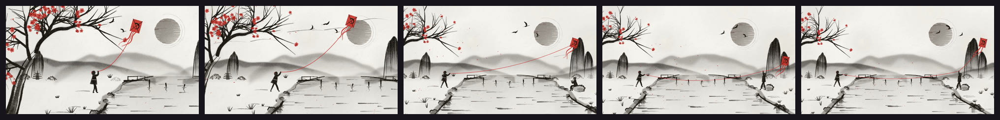

# Sumi-e



Japanese ink painting on washi: one black ink in many greys, brush strokes with tapered
ends and dry-brush streaks, mountains as washes dissolving into mist, water as horizontal
strokes with reflections, tiny ink silhouettes for people, and vermilion as the only colour.

**Status:** in testing · **Skill:** [`style-sumi-e`](../../.claude/skills/style-sumi-e/SKILL.md) (the rules and the checklist that keep every video in the style consistent)

## Start a video in this style

```bash
node engine/new.mjs my-test --style sumi-e --aspect 16:9 --duration 6
npm run preview    # http://127.0.0.1:5173
```

`template.js` is the minimal scene `new.mjs` copies.

## Files

| File | What it gives |
|---|---|
| `template.js` | a branch painting itself under a red sun, blossoms, mountains in mist |
| `sumi.js` | `Sumi`: the brush (wet core, bristles, kasure) and its grain, dabs, washes, boneless mountains, karst peaks, the sun with halo rings, grown plum trees with blossoms and petals, cranes, tree clumps, pagodas, reeds, washi paper, a hanko seal |

## Made with it

- [red-thread](../../sandbox/2026-11-04-red-thread/) · «El hilo rojo», style test: a girl's red kite crosses a river to a boy on his phone · [mp4](../../sandbox/2026-11-04-red-thread/render/red-thread.mp4)
