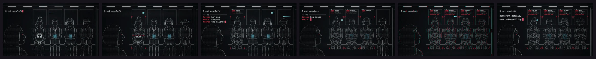

# Terminal



The whole frame is one character grid, like a text-mode screen. Pictures are painted as
light and turned into characters (strokes become `| / \ _ - ( )`, flat areas a density
ramp, a scanned shape fills with its own words), text is typed into the cells, and the
grid is finished like a tube: phosphor bloom, scanlines, a vignette, grain, and glitches
on the hits. Near-black, phosphor white and one red.

**Status:** in testing · **Skill:** [`style-terminal`](../../.claude/skills/style-terminal/SKILL.md) (the rules and the checklist that keep every video in the style consistent)

## Start a video in this style

```bash
node engine/new.mjs my-test --style terminal --aspect 16:9 --duration 6
npm run preview    # http://127.0.0.1:5173
```

`template.js` is the minimal scene `new.mjs` copies.

## Files

| File | What it gives |
|---|---|
| `template.js` | someone types a command, a moon made of characters rises behind a skyline typed into the grid, a line resolves out of noise |
| `term.js` | `Term`: the grid (cells, large text, boxes, the cursor), pictures turned into characters by shape matching, typing and printing in time, the tube (bloom, scanlines, vignette, grain) and glitches |

Font: JetBrains Mono (OFL), in `fonts/`.

## Made with it

- [one-or-zero](../../sandbox/2026-11-10-one-or-zero/) · style test: `cat people/*`, a carriage at night where every passenger opens as the same three-line record · [mp4](../../sandbox/2026-11-10-one-or-zero/render/one-or-zero.mp4)
