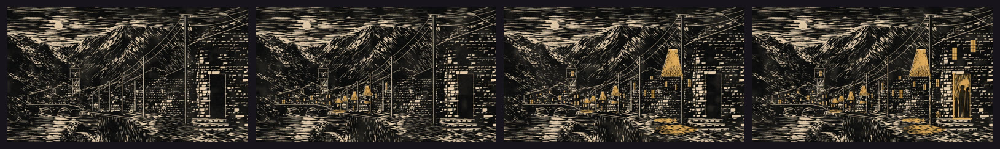

# Woodcut



A relief print cut in a plank. A scene is worked on a block with two gestures, ink and cut:
every white is a gouge cut, laid in runs down each slope, in long horizontal cuts across the
sky, along the courses of a stone wall, out from a light. A second block in one ochre prints
only what a light touches, a little out of register. The press gives the paper, an uneven
film of ink (the roller's passes, starved patches, the grain, specks of paper in the black)
and a fresh inking on every drawing, so the animation moves its ink and never its cuts. For
serious, solid narrative pieces: history, labour, villages, mountains, night.

**Status:** in testing · **Skill:** [`style-woodcut`](../../.claude/skills/style-woodcut/SKILL.md) (the rules and the checklist that keep every video in the style consistent)

## Start a video in this style

```bash
node engine/new.mjs my-test --style woodcut --duration 4
npm run preview    # http://127.0.0.1:5173
node engine/render.mjs sandbox/<exp>/scene.js --size 1920
```

`template.js` is the minimal scene `new.mjs` copies.

## Files

| File | What it gives |
|---|---|
| `template.js` | a village corner at night: a sky of horizontal cuts, a slope of flicks, a stone house, a lamp that comes on (its cone carved down from the hood, ochre printed) and a window |
| `woodcut.js` | `Woodcut`: `block` (ink, cut, a cached `base`, `hatch` with a tone `fit`, the ochre block, the press), the marks (`gouge`, `groove`, `rays`), `masonry` (rubble stone carved as blocks) and `noise2` |

## Made with it

| Video | What it is |
|---|---|
| [light-valley](../../sandbox/2026-11-17-light-valley/) | the style test: the night the electric light reaches a mountain village; the lamps, windows and a door are carved out of the black block one by one and printed in ochre (6 s, matched to a generated still) |
